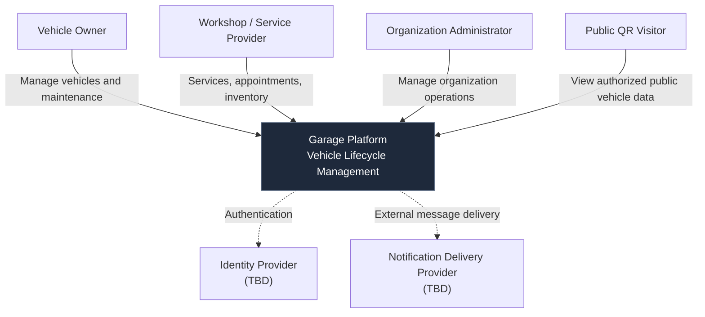

# System Context Diagram

**Project:** Garage Platform
**Level:** C4 — System Context
**Status:** Draft
**Updated:** 2026-10-26

## Purpose

Describe Garage Platform as a single software system
and identify the primary actors and external dependencies.

This diagram intentionally excludes internal microservices,
databases, and implementation technologies.

## Diagram

## Actors

### Vehicle Owner

An individual or legal entity associated with a vehicle.

A legal owner is not necessarily an authenticated
platform user.

### Workshop / Service Provider

An organization authorized to perform or record
vehicle services.

A workshop does not automatically own the vehicle
or its entire historical record.

### Organization Administrator

An authorized user responsible for managing
organization operations and access.

Actual permissions must be defined through
the authorization model.

### Public QR Visitor

A person possessing an authorized QR access token.

Access is limited to a vehicle-specific public
information projection.

Public access does not imply account membership.

## External Systems

### Identity Provider

Potential provider of authentication services.

The provider and integration strategy are not yet approved.

### Notification Delivery Provider

Potential external service for delivering
notifications through supported channels.

The provider and channels are not yet approved.

## Architectural Constraints

- Vehicle ownership and platform identity are distinct.
- Organizations do not automatically own vehicle history.
- Public QR access is scoped and revocable.
- Backend services enforce authorization.
- External integrations require explicit contracts.
- Internal service design is intentionally omitted.

## Related Documentation

- [System Overview](../system-overview.md)
- [Architecture Constitution](../constitution.md)
- [ADR-0010: Identity and Tenancy](../decisions/0010-identity-and-tenancy.md)
- [ADR-0011: Public QR Access](../decisions/0011-public-qr-access.md)

## Open Questions

- Identity provider selection.
- Organization and tenancy model.
- Cross-organization history sharing.
- Notification delivery channels.
- Detailed user roles and permission boundaries.

These unresolved questions must not be interpreted
as approved implementation decisions.
