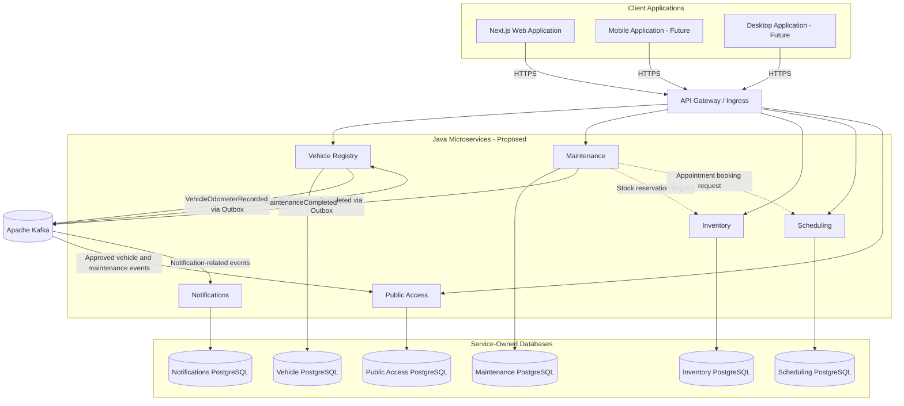

# Container Architecture

**Project:** Garage Platform
**Model:** C4 - Level 2
**Version:** 0.1.0
**Status:** Draft

---

## 1. Purpose

This document describes the proposed runtime architecture
of Garage Platform.

It identifies client applications, backend services,
persistence boundaries, and integration infrastructure.

This diagram represents logical containers.

It does not mandate a particular Docker, Kubernetes,
cloud, or physical deployment topology.

Bounded-context boundaries are defined separately
and must be validated before final deployment decisions.

## 2. Container Diagram

## 3. Client Applications

### Web Application

Technology: Next.js and TypeScript.

Responsibilities:

- User interaction.
- Presentation and navigation.
- Authentication integration.
- Application composition.
- Consuming backend APIs.
- Reusing framework-independent TypeScript modules.

The web application must not implement
authoritative backend business rules.

### Mobile Application

Status: Future.

The mobile application should reuse compatible
TypeScript Core and Application modules.

Its presentation and platform adapters may differ.

### Desktop Application

Status: Future.

The desktop application should reuse appropriate
application behavior and compatible shared UI.

The desktop runtime remains undecided.

## 4. API Entry Layer

The platform may use an API Gateway or ingress layer.

Candidate responsibilities:

- Request routing.
- Transport security.
- Authentication integration.
- Rate limiting.
- Request correlation.

The gateway must not become the owner of
domain business logic.

Backend services remain responsible for
resource authorization.

The gateway implementation and the handling
of server-side frontend requests remain open decisions.

Public QR endpoints must support unauthenticated
requests only when accompanied by valid scoped
public access credentials.

## 5. Java Microservices

Each backend service:

- Uses Java and Maven.
- Is independently deployable.
- Owns its persistence model.
- Defines explicit integration contracts.
- Follows the approved modular Hexagonal Architecture.
- Uses local transactions for its own state changes.
- Implements Outbox and Inbox when required.
- Participates in Saga workflows when appropriate.

Candidate services:

### Vehicle Registry

Owns vehicle identity, ownership history,
and authoritative odometer observations.

### Maintenance

Owns service records, maintenance plans,
maintenance due calculations, and service orders.

### Inventory

Owns spare parts, stock, reservations,
consumption, and inventory movements.

### Scheduling

Owns appointments and availability.

### Public Access

Owns public QR credentials and restricted
vehicle information projections.

### Notifications

Owns notification delivery and delivery state.

A public HTTP interface is not mandatory
for every service.

Service boundaries remain proposed until
their corresponding bounded-context decisions
are accepted.

## 6. Persistence Ownership

Every service must own its database schema
and persistence lifecycle.

A service must not access another service's
database directly.

Logical database independence does not require
a dedicated physical PostgreSQL server
for every microservice.

Multiple service-owned databases may share
a PostgreSQL cluster when operationally appropriate.

Each service must own its migrations.

Cross-service consistency must not depend
on direct foreign keys between service databases.

## 7. Apache Kafka

Kafka provides asynchronous integration
between independently deployed services.

Events must use versioned integration contracts.

Domain Events must remain distinct from
public Integration Events.

Kafka does not replace synchronous APIs
where immediate responses are required.

Consumer processing must tolerate duplicates
and account for ordering requirements.

## 8. Outbox and Inbox

A service may persist integration events
using Transactional Outbox.

Business state and outbox messages must share
the same physical local transaction.

The event relay implementation remains undecided.

An Inbox or equivalent mechanism may persist
message-processing identity and support idempotency.

The consumer must not apply the same business
effect twice because of Kafka redelivery.

Outbox and Inbox are internal technical capabilities
and are not represented as separate microservices
in this container diagram.

## 9. Maintenance Odometer Propagation

Maintenance publishes MaintenanceCompleted
after the associated business transaction commits.

The event includes an observed odometer reading.

Vehicle Registry consumes the event.

Vehicle Registry independently:

1. Validates the observation.
2. Verifies message idempotency.
3. Applies odometer domain rules.
4. Persists the observation.
5. Updates the current reading when appropriate.

Vehicle Registry may publish VehicleOdometerRecorded.

Maintenance completion does not require synchronous
confirmation from Vehicle Registry.

This integration uses eventual consistency.

It does not require Saga merely to propagate
the odometer reading.

See ADR-0016.

## 10. Distributed Workflow Coordination

Complex workflows may use Saga.

For example, maintenance booking may require:

- Creating a maintenance order.
- Reserving inventory.
- Reserving an appointment.
- Confirming the overall booking.
- Executing valid compensations on failure.

The relevant business context owns its Saga.

Saga state must be persisted and recoverable.

The selected execution engine is not yet decided.

Saga, Outbox, and Inbox have separate responsibilities.

## 11. Frontend Integration

Frontend applications communicate with backend
services through approved API entry points.

Generated TypeScript clients may consume
versioned OpenAPI contracts.

HTTP adapters must isolate the generated
transport clients from reusable application behavior.

Frontend applications must not connect
directly to Kafka.

Realtime functionality may be exposed through
approved SSE or WebSocket interfaces.

The final realtime design remains undecided.

## 12. Security Boundaries

Authentication and authorization are separate.

Backend authorization is authoritative.

Every protected operation must validate
the applicable permissions.

Vehicle ownership and platform user identity
must remain distinct.

Organization and tenant isolation rules
must be established before implementation
of multi-organization data access.

Public QR access must be scoped and revocable.

The identity provider remains undecided.

## 13. Observability

Services should support standardized
distributed telemetry.

Candidate capabilities include:

- OpenTelemetry instrumentation.
- Prometheus metrics.
- Grafana dashboards.
- Centralized structured logs.
- Elasticsearch and Kibana.
- Zabbix infrastructure monitoring.

The final observability deployment remains
subject to ADR-0012.

Cross-service operations must preserve
appropriate correlation context.

## 14. Deployment Independence

A shared Git repository must not imply
shared service deployments.

Each service must support:

- Independent build.
- Independent testing.
- Independent artifact packaging.
- Independent deployment.
- Independent runtime configuration.

Shared contracts must preserve compatibility
between independently deployed versions.

## 15. Open Decisions

- API Gateway implementation.
- Authentication provider.
- Final service deployment boundaries.
- Tenant persistence strategy.
- Kafka schema format and registry.
- Outbox relay implementation.
- Saga execution engine.
- Deployment orchestrator.
- Realtime communication strategy.
- Observability storage and deployment.
- Service discovery and configuration strategy.

## 16. Related Documentation

- [Architecture Constitution](../constitution.md)
- [System Overview](../system-overview.md)
- [Bounded Context Map](02-bounded-context-map.md)
- [ADR-0002](../decisions/0002-modular-hexagonal-backend.md)
- [ADR-0004](../decisions/0004-event-driven-integration.md)
- [ADR-0005](../decisions/0005-transactional-outbox-inbox.md)
- [ADR-0006](../decisions/0006-saga-coordination.md)
- [ADR-0015](../decisions/0015-bounded-context-boundaries.md)
- [ADR-0016](../decisions/0016-maintenance-odometer-propagation.md)

## Final Principle

Service autonomy must remain compatible
with explicit business ownership.

Kafka provides asynchronous integration.

Local transactions protect local consistency.

Saga coordinates distributed business workflows.

The frontend remains independent of
backend implementation details.

The system must remain independently deployable
without sacrificing domain boundaries.
