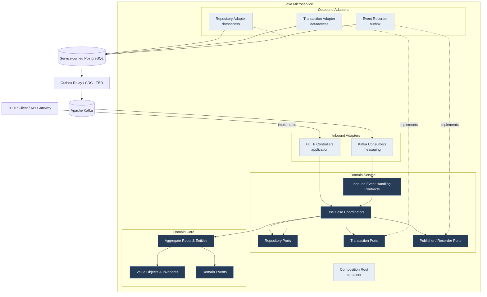
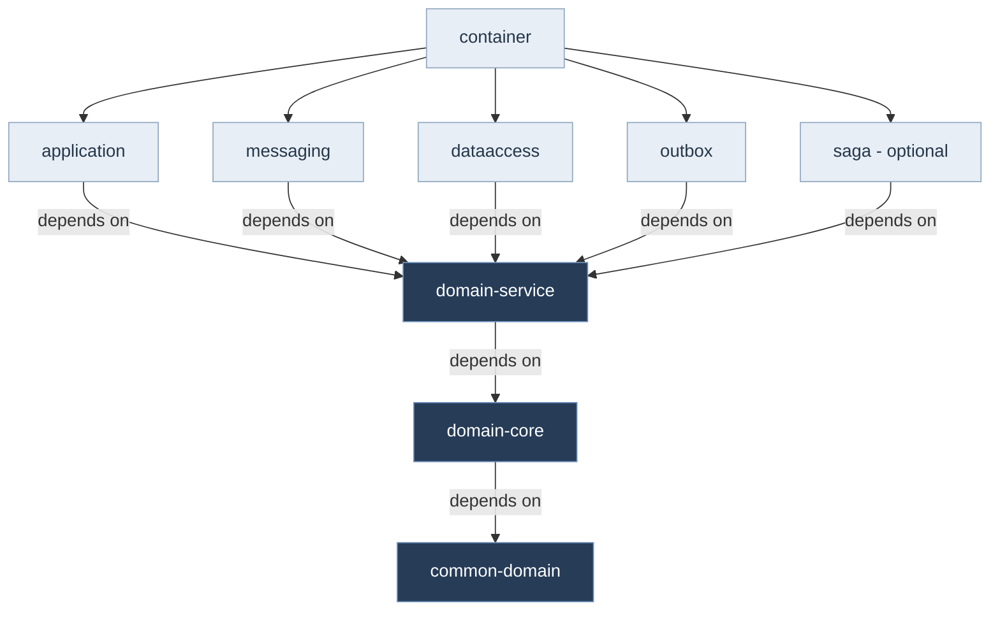

# Backend Component Architecture

**Project:** Garage Platform
**Model:** C4 Level 3 + Maven Dependency Architecture
**Version:** 0.1.0
**Status:** Draft
**Scope:** Internal architecture of a Java microservice

---

## 1. Purpose

This document defines the internal component structure
and module dependency direction of a typical Java
microservice within Garage Platform.

It complements ADR-0002 and the Architecture Constitution.

The architecture combines:

- Domain-Driven Design.
- Hexagonal Architecture.
- Rich Domain Models.
- Event-Driven Architecture.
- Dependency Inversion.
- Local transactional consistency.
- Transactional Outbox and Inbox.
- Saga-based distributed coordination.

This document distinguishes runtime collaboration
from compile-time module dependencies.

---

## 2. Component Diagram

### Diagram Interpretation

Solid arrows represent logical calls, data flows,
or interactions between components.

Dashed arrows marked "implements" represent
adapter implementations of domain-defined ports.

The PostgreSQL-to-Kafka path represents a
reliable publication mechanism whose exact
implementation remains undecided.

The Composition Root assembles components
through dependency injection.

Its constructor wiring is intentionally omitted
from the runtime diagram for readability.

Not every service requires every component.

---

## 3. Maven Module Structure

A typical microservice uses:

    <name>-service/
    |
    |-- pom.xml
    |
    |-- <name>-domain/
    |   |-- pom.xml
    |   |-- <name>-domain-core/
    |   `-- <name>-domain-service/
    |
    |-- <name>-application/
    |-- <name>-messaging/
    |-- <name>-outbox/
    |-- <name>-saga/
    |-- <name>-dataaccess/
    `-- <name>-container/

The service root and domain aggregator use
Maven POM packaging.

Domain Core and Domain Service are regular
Java library modules.

The Container module produces the executable
Spring Boot application.

Technical modules may be omitted when their
responsibilities are not required.

---

## 4. Compile-Time Dependency Diagram

Arrows represent compile-time dependency direction.

Infrastructure modules may additionally depend
on Domain Core for required domain types.

Approved shared technical modules may also be used.

The diagram does not represent all third-party
dependencies.

The dependency graph must remain acyclic.

---

## 5. Domain Core

The Domain Core contains:

- Entities.
- Aggregate Roots.
- Value Objects.
- Domain Errors.
- Domain Events.
- Domain invariants.
- Factories and Builders.
- Pure Specifications when appropriate.

Domain Core must not depend on infrastructure.

It may depend on common-domain.

### Aggregate Responsibilities

An Aggregate Root:

- Protects its consistency boundary.
- Validates state transitions.
- Controls internal entities.
- Records relevant Domain Events.

It does not:

- Persist itself.
- Manage database transactions.
- Send HTTP requests.
- Publish Kafka messages.
- Depend on Spring.

Creation and reconstitution are distinct operations.

Reconstitution must not emit creation events.

---

## 6. Domain Service

Domain Service owns use-case coordination.

Responsibilities include:

- Executing application-level business operations.
- Loading aggregates.
- Invoking domain behavior.
- Coordinating cross-aggregate processes.
- Using repository ports.
- Establishing local transaction boundaries.
- Recording events through publisher ports.
- Exposing transport-independent event handlers.

Intrinsic aggregate invariants must remain
inside Domain Core.

Domain Service does not own infrastructure
implementations.

### Port Organization

Ports are defined under:

    domain-service/
        ports/
            repositories/
            transactions/
            listeners/
            publishers/

The directory name is ports, not adapters.

Port contracts must express domain-service
requirements rather than technical details.

### Repository Ports

Repository ports expose operations over
domain aggregates or justified domain models.

They must not expose:

- JPA entities.
- EntityManager.
- Spring Data repositories.
- SQL query implementation details.

### Transaction Ports

A transaction port may provide UnitOfWork semantics.

Domain Service defines which operations
must be atomic.

DataAccess implements the local transaction mechanism.

### Publisher Ports

Publisher or recorder ports must clearly
distinguish event recording from external delivery.

An Outbox implementation may record an integration
message transactionally without immediately
sending it to Kafka.

### Listener Ports

Listener ports represent transport-independent
entry contracts.

Kafka-specific annotations, consumer configuration,
and integration event deserialization belong
to the Messaging adapter.

External Integration Events should be mapped
to suitable application commands or models.

---

## 7. Inbound Adapters

### Application

The application module implements inbound
HTTP-related responsibilities.

It may contain:

- REST controllers.
- Request and response DTOs.
- HTTP validation.
- Authentication context extraction.
- Error-to-HTTP mapping.

It must not implement authoritative business rules.

### Messaging

The messaging module implements message transport.

It may contain:

- Kafka listeners.
- Integration event deserialization.
- Contract version handling.
- Event-to-command mapping.
- Correlation propagation.
- Technical error handling.

Incoming messages must invoke Domain Service
through its approved entry contracts.

Message redelivery must be considered.

---

## 8. DataAccess

DataAccess implements technical persistence.

Responsibilities include:

- JPA entities.
- Spring Data repositories.
- Domain-to-persistence mapping.
- Persistence-to-domain reconstitution.
- Database queries.
- Transaction adapters.
- Concurrency controls.
- Database constraint handling.

Persistence models and Domain Aggregates
must remain separate.

DataAccess must not take ownership of
business workflows.

DataAccess must not introduce public setters
into the domain merely for persistence mapping.

---

## 9. Local Transaction Boundary

The domain-service controls the operation sequence.

Example:

    RegisterVehicleService
        |
        |-- Validate domain input
        |-- Construct Vehicle aggregate
        |
        `-- UnitOfWork.execute()
                |
                |-- Validate database-dependent rules
                |-- VehicleRepository.save(vehicle)
                |-- EventRecorder.record(events)
                |
                `-- Commit / Rollback

The repository and outbox recorder must participate
in the same physical local transaction.

The actual implementation may use Spring's
transaction management infrastructure.

Domain Service must not depend on Spring
transaction APIs.

The transaction must be verified through
integration tests.

---

## 10. Outbox

The Outbox module provides reliable integration
event recording.

Responsibilities may include:

- Event serialization.
- Integration event mapping.
- Outbox persistence.
- Event envelopes.
- Technical delivery metadata.

The event recorder implements a domain-service port.

It must participate in the transaction
defined by the coordinating use case.

Outbox is not a business workflow engine.

The relay or CDC mechanism may run outside
the executable application process.

Its final implementation requires a
separate technical decision.

---

## 11. Inbox and Idempotency

Incoming message processing must tolerate
duplicate delivery.

A durable Inbox may be implemented using
service-owned persistence infrastructure.

The Inbox pattern does not automatically
require a separate Maven module.

Message deduplication and the relevant
business state updates must be coordinated
transactionally when required.

Messaging adapters must not assume that
Kafka delivery guarantees ensure exactly-once
business effects in PostgreSQL.

---

## 12. Saga

Saga coordination supports workflows spanning
multiple independently persisted business operations.

A Saga module is optional.

Its technical responsibilities may include:

- Persistent execution state.
- Retry scheduling.
- Timeout management.
- Recovery.
- Dispatching compensation requests.

The owning Domain Service defines business
workflow transitions and compensation semantics.

A Saga must not turn multiple independent
service databases into a fictional global
ACID transaction.

Saga and Outbox remain separate concerns.

---

## 13. Container

The Container module is the Composition Root.

It owns:

- Spring Boot startup.
- Dependency injection configuration.
- Runtime module composition.
- Infrastructure configuration.
- Application lifecycle.
- Executable artifact packaging.

It may depend on all required modules.

It must not contain authoritative
business rules.

Only the Container is expected to assemble
the complete runtime dependency graph.

---

## 14. Common Modules

Approved shared backend modules may include:

- common-domain
- common-web
- common-messaging
- common-observability

Common Domain must remain framework-independent.

Technical common modules may depend on
their respective technical frameworks.

No common module may become a repository
for unrelated bounded-context business rules.

Shared code must not create prohibited
cross-service domain coupling.

---

## 15. Example: MaintenanceCompleted Consumption

Vehicle Registry may receive MaintenanceCompleted.

The processing flow is:

1. Messaging receives the versioned Integration Event.
2. Messaging validates its transport contract.
3. Messaging maps the payload into an application command.
4. Domain Service checks processing idempotency.
5. Domain Service invokes odometer domain behavior.
6. DataAccess persists the observation.
7. Inbox state is recorded atomically when required.
8. Outbox records new integration events if applicable.
9. The local transaction commits.
10. Publication infrastructure eventually delivers
    committed integration messages.

The Vehicle Aggregate must not depend on
Maintenance's internal Java domain classes.

The authoritative odometer rules remain
inside Vehicle Registry.

This flow follows ADR-0016.

---

## 16. Dependency Restrictions

The following dependencies are forbidden:

- domain-core -> Spring
- domain-core -> JPA
- domain-core -> messaging
- domain-core -> dataaccess
- domain-service -> application
- domain-service -> messaging
- domain-service -> outbox
- domain-service -> dataaccess
- domain-service -> container
- any service -> another service's internal database
- any service -> another service's internal domain code

All Maven module dependency graphs must remain acyclic.

---

## 17. Verification Requirements

### Domain Tests

- Pure Java execution.
- Aggregate invariants.
- Value Object behavior.
- Domain Events.
- Creation and reconstitution.
- Controlled mutability.

### Domain Service Tests

- In-memory repositories.
- Fake event recorders.
- Fake transaction execution.
- Business operation coordination.
- Error and failure behavior.

### Infrastructure Tests

- JPA persistence.
- Reconstitution mapping.
- Database constraints.
- Transaction propagation.
- Outbox atomicity.
- Inbox idempotency.
- Saga recovery when applicable.

### Architecture Tests

ArchUnit and Maven dependency checks
should enforce approved module boundaries.

No infrastructure framework dependency
may enter Domain Core.

No cyclic module dependency is permitted.

---

## 18. Open Decisions

- Exact parent POM conventions.
- Exact Java and Spring versions.
- UnitOfWork final contract.
- Outbox relay or CDC implementation.
- Inbox module placement if complexity increases.
- Saga execution engine.
- Domain Event lifecycle implementation.
- Aggregate concurrency version representation.
- Java package naming conventions.
- Shared technical module dependencies.

Open decisions must not become accidental
requirements during initial implementation.

---

## 19. Related Documentation

- [Architecture Constitution](../constitution.md)
- [System Overview](../system-overview.md)
- [Container Architecture](03-container-architecture.md)
- [ADR-0002](../decisions/0002-modular-hexagonal-backend.md)
- [ADR-0003](../decisions/0003-rich-domain-model.md)
- [ADR-0005](../decisions/0005-transactional-outbox-inbox.md)
- [ADR-0006](../decisions/0006-saga-coordination.md)
- [ADR-0016](../decisions/0016-maintenance-odometer-propagation.md)

## Final Principle

Domain Core owns invariants.

Domain Service coordinates business operations.

Ports express required capabilities.

Infrastructure adapters implement those capabilities.

Container assembles the runtime.

Local transactions preserve local consistency.

Saga coordinates distributed business workflows.

Dependency direction must always protect
the domain from infrastructure.
