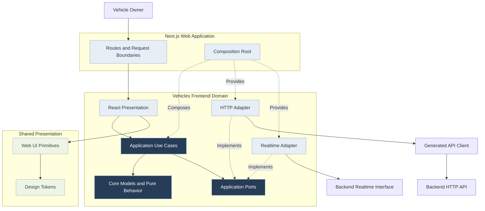
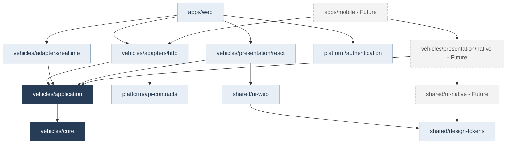
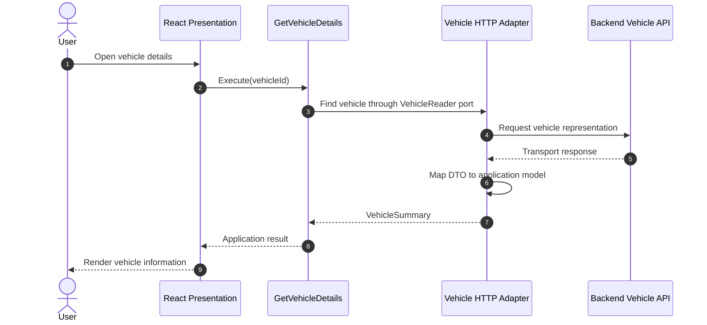

# Frontend Component Architecture

**Project:** Garage Platform
**Model:** C4 Level 3 + Workspace Dependency Architecture
**Version:** 0.1.0
**Status:** Draft
**Scope:** Frontend applications and reusable TypeScript packages

---

## 1. Purpose

This document defines the proposed internal architecture
of Garage Platform frontend applications.

It describes:

- Framework-independent domain modules.
- Reusable application use cases.
- Ports and infrastructure adapters.
- React presentation components.
- Application Composition Roots.
- Shared UI and design tokens.
- Backend integration contracts.
- Compile-time dependency boundaries.

The frontend is not defined by a single framework.

Next.js is the initial web application framework,
not the owner of reusable application behavior.

---

## 2. Architectural Principles

The frontend follows:

- Domain-oriented modular architecture.
- Hexagonal Architecture.
- Dependency Inversion.
- Separation of interaction and server state.
- Reusable application behavior.
- Explicit integration boundaries.
- Shared presentation primitives.
- Backend-authoritative business rules.

Frontend modules must be organized around
meaningful capabilities rather than only
technical file categories.

A frontend domain does not have to map
one-to-one to a backend microservice.

Frontend boundaries must reflect application
behavior and reuse requirements without
violating backend data ownership.

---

## 3. Proposed Workspace Structure

    frontend/
    |
    |-- package.json
    |-- pnpm-workspace.yaml
    |-- tsconfig.base.json
    |
    |-- apps/
    |   |-- web/
    |   |-- mobile/                  # Future
    |   `-- desktop/                 # Future
    |
    |-- domains/
    |   |-- vehicles/
    |   |   |-- core/
    |   |   |-- application/
    |   |   |-- adapters/
    |   |   |   |-- http/
    |   |   |   `-- realtime/
    |   |   `-- presentation/
    |   |       `-- react/
    |   |
    |   |-- maintenance/
    |   |-- inventory/
    |   |-- scheduling/
    |   `-- public-access/
    |
    |-- shared/
    |   |-- design-tokens/
    |   |-- ui-web/
    |   `-- ui-native/              # Future
    |
    `-- platform/
        |-- api-contracts/
        |-- authentication/
        `-- observability/

This is a conceptual structure.

Directories may become independently versioned
workspace packages when useful.

No module should be created solely to satisfy
a diagram if it has no meaningful responsibility.

---

## 4. Runtime Component Diagram

The following diagram uses the Vehicles capability
as an example.

### Diagram Semantics

Solid arrows represent logical collaboration.

Dashed arrows represent adapter implementation
or dependency composition.

Application Ports are TypeScript contracts,
not independently running processes.

Generated API clients are transport infrastructure.

The exact HTTP and realtime topology remains
subject to backend integration decisions.

---

## 5. Compile-Time Dependency Diagram

This diagram shows permitted source-code
dependency direction.

Arrows point from the importing package
toward the package it depends upon.

The diagram shows representative dependencies,
not a requirement for every possible import.

Application may depend on its own Core.

Infrastructure and Presentation may depend on
Application and approved Core models.

The application Composition Root may depend
on infrastructure adapters and presentation packages.

Core must never depend on Application,
Adapters, Presentation, or framework packages.

Application must never depend on Adapters,
Presentation, or framework packages.

The dependency graph must remain acyclic.

---

## 6. Core

Core contains framework-independent models
and behavior relevant to frontend capabilities.

Candidate responsibilities:

- Value Objects.
- Read models.
- Pure transformations.
- Client interaction rules.
- Domain-oriented error representations.
- Framework-independent state transitions.

Core must not depend on:

- React.
- Next.js.
- React Router.
- Expo.
- Electron.
- Tauri.
- Browser-specific APIs.
- Infrastructure adapters.

Core must not duplicate all backend aggregates.

Only behavior required by frontend capabilities
should be represented.

Authoritative business validation remains
the responsibility of backend services.

---

## 7. Application

Application contains reusable use cases
and interaction workflows.

Responsibilities may include:

- Loading vehicle information.
- Coordinating maintenance forms.
- Applying filters and selections.
- Coordinating user interactions.
- Translating technical outcomes into
  meaningful application results.
- Defining external dependency ports.

### Example Application Port

A conceptual port may be expressed as:

    interface VehicleReader {
      findById(vehicleId: VehicleId): Promise<VehicleSummary>;
    }

This is an illustrative contract, not an
approved final TypeScript API.

The Application layer defines the contract
required by its use cases.

The concrete HTTP implementation belongs
in the corresponding adapter.

### Use Cases

Use cases should expose meaningful operations.

Examples:

- GetVehicleDetails.
- ListVehicleMaintenance.
- PrepareMaintenanceRequest.
- RevokePublicVehicleAccess.

Use cases must not import concrete React hooks,
Next.js routing utilities, or HTTP client instances.

Trivial forwarding wrappers should not be
introduced without a meaningful responsibility.

Application tests must be executable with
in-memory implementations of external ports.

---

## 8. HTTP Adapters

HTTP adapters connect application contracts
to approved backend APIs.

Responsibilities include:

- Calling generated transport clients.
- Mapping transport DTOs.
- Translating transport errors.
- Handling approved authentication context.
- Mapping server responses into frontend models.

Adapters must preserve relevant precision
and domain meaning.

Generated transport DTOs must not automatically
be exposed as application domain models.

The backend's authorization decisions
must remain authoritative.

### API Contract Generation

HTTP contracts should be described
using OpenAPI.

Generated TypeScript clients may be stored
in an approved platform package.

The exact generator remains undecided.

Generated source code should be reproducible
from version-controlled contracts.

---

## 9. Realtime Adapters

Realtime adapters implement application-defined
subscription or update contracts.

Approved candidate transports include:

- Server-Sent Events.
- WebSocket.

The final transport is not yet selected.

Realtime events must be translated into
application-relevant changes.

A frontend application must not subscribe
directly to Apache Kafka.

Transport reconnection, error handling,
and subscription cleanup belong to
appropriate adapter or platform layers.

Application behavior should not depend
on the selected realtime protocol.

---

## 10. Presentation

Presentation contains framework-specific
rendering and interaction integration.

For the initial web application,
Presentation may include:

- React components.
- React hooks.
- Forms.
- View models.
- Query library integration.
- Loading and error views.
- Interaction event handlers.

Presentation invokes Application use cases.

Presentation may display backend validation errors,
but it must not bypass backend authorization
or authoritative business validation.

Domain-specific presentation components
should remain in their owning frontend domain.

Examples:

- VehicleCard.
- VehicleOwnershipTimeline.
- MaintenanceHistory.
- InventoryReservationStatus.

---

## 11. Shared Design System

Shared design tokens establish visual conventions.

Possible token categories include:

- Colors.
- Typography.
- Spacing.
- Radius.
- Elevation.
- Motion.
- Semantic states.

Web UI components may provide:

- Buttons.
- Inputs.
- Forms.
- Dialogs.
- Tables.
- Navigation primitives.
- Accessible feedback components.

Shared UI components must remain generic.

Domain-specific business behavior must not
be moved into shared UI packages.

Mobile applications may use a separate
native UI implementation.

Shared design principles do not require
identical component technology on every platform.

---

## 12. Application Composition Roots

Each deployable frontend application owns
its Composition Root.

The Composition Root selects:

- Application use cases.
- HTTP adapters.
- Realtime adapters.
- Authentication integrations.
- State management integrations.
- Presentation dependencies.
- Platform-specific implementations.

Composition must respect the intended
execution environment.

### Web

Next.js owns web routing and request boundaries.

Server-side execution must preserve
request-specific security context.

User-specific credentials must not be
stored in globally shared mutable singletons.

### Mobile

A future mobile application will provide
platform-specific adapters and presentation.

It should reuse compatible Core
and Application behavior.

### Desktop

A future desktop application may reuse
web-compatible presentation where appropriate.

The desktop runtime remains undecided.

---

## 13. Example Request Flow

This sequence illustrates loading
a vehicle summary through an application use case.

The Composition Root provides the concrete
VehicleReader implementation to the use case.

The use case does not know which HTTP client,
framework, or transport endpoint was used.

A server-side web implementation may execute
some of these steps on the server.

The diagram is logical and does not prescribe
a browser-to-backend network topology.

---

## 14. State Management

Remote server state and local interaction state
must remain distinct.

### Server State

May include:

- Remote caching.
- Request deduplication.
- Refetching.
- Revalidation.
- Remote loading and error states.

The query/cache library remains undecided.

### Interaction State

May include:

- Form progress.
- Dialog visibility.
- Filter selections.
- Multi-step workflows.
- Temporary UI selections.

A dedicated state management library may be
introduced when justified.

Framework-specific state libraries must remain
outside Core and Application.

Do not maintain redundant authoritative copies
of remote business data without justification.

---

## 15. Authentication and Authorization

Frontend applications may manage authentication
integration and session presentation.

They must not become the authoritative
authorization decision-maker.

Backend services must validate permissions
for protected operations.

UI visibility restrictions are not security
boundaries.

Public QR access uses independently scoped
credentials.

Session management must account for:

- Client-side execution.
- Server-side rendering.
- Request isolation.
- Credential storage.
- Expiration and renewal.
- Logout and revocation.

The identity provider remains undecided.

---

## 16. Error Handling

Errors should be translated at the
appropriate architectural boundary.

Transport adapters interpret:

- Network failures.
- HTTP status codes.
- Transport serialization errors.
- Backend error contracts.

Application use cases interpret failures
relevant to the user's intended operation.

Presentation determines how to communicate
those outcomes visually.

A network exception must not automatically
be treated as a domain validation error.

Errors containing private information must
not be exposed directly to end users.

---

## 17. Accessibility

Shared UI and domain presentation should support:

- Keyboard interaction.
- Semantic controls.
- Accessible names.
- Focus management.
- Appropriate contrast.
- Error announcement.
- Responsive layouts.
- Reduced-motion preferences.

Accessibility must be tested in the
actual target presentation environment.

---

## 18. Testing Strategy

### Core Tests

Verify:

- Value Object behavior.
- Pure transformations.
- Relevant state transitions.
- Error semantics.

These tests must not require React or Next.js.

### Application Tests

Verify:

- Use-case behavior.
- Port interaction.
- Failure handling.
- Application state transitions.
- Correct result mapping.

These tests should use in-memory
or fake adapter implementations.

### Adapter Tests

Verify:

- HTTP contract integration.
- Transport DTO mapping.
- Error translation.
- Authentication behavior.
- Realtime connection behavior.

### Presentation Tests

Verify:

- Relevant rendering behavior.
- User interaction.
- Loading and error states.
- Accessibility.
- Component integration.

### Architecture Tests

Automated checks must detect:

- React imports in Core.
- Next.js imports in Application.
- Adapter imports in Core or Application.
- Circular package dependencies.
- Forbidden cross-domain implementation imports.

---

## 19. Compile-Time Boundary Rules

The following dependency directions
are forbidden:

    core -> application
    core -> adapters
    core -> presentation
    core -> apps

    application -> adapters
    application -> presentation
    application -> apps

    shared/design-tokens -> React
    shared/design-tokens -> Next.js

Framework-independent modules must
not rely on presentation framework types.

Workspace packages must explicitly
declare their dependencies.

Circular dependencies are prohibited.

---

## 20. Open Decisions

The following choices remain unresolved:

1. Exact TypeScript and pnpm versions.
2. Workspace package naming conventions.
3. HTTP client generation technology.
4. Server-state query library.
5. Local interaction state library.
6. Web styling technology.
7. UI component primitives.
8. Mobile framework selection.
9. Desktop runtime selection.
10. Realtime transport strategy.
11. Frontend authentication integration.
12. Package-level architecture enforcement tooling.
13. Shared component documentation tooling.

Open decisions must not become accidental
requirements during implementation.

---

## 21. Related Documentation

- [Architecture Constitution](../constitution.md)
- [System Overview](../system-overview.md)
- [Container Architecture](03-container-architecture.md)
- [Backend Components](04-backend-components.md)
- [ADR-0007: Frontend Architecture](../decisions/0007-framework-independent-frontend.md)
- [ADR-0008: Shared UI](../decisions/0008-shared-ui-design-system.md)
- [ADR-0009: Contract Governance](../decisions/0009-contract-governance.md)
- [ADR-0014: Architecture Enforcement](../decisions/0014-testing-and-architecture-enforcement.md)

## Final Principle

Core expresses framework-independent models and behavior.

Application coordinates reusable use cases.

Ports express external capabilities.

Adapters implement those capabilities.

Presentation renders and integrates user interaction.

Applications assemble their dependencies.

The backend remains authoritative for business rules.

Framework replacement must not require rewriting
reusable application behavior.
