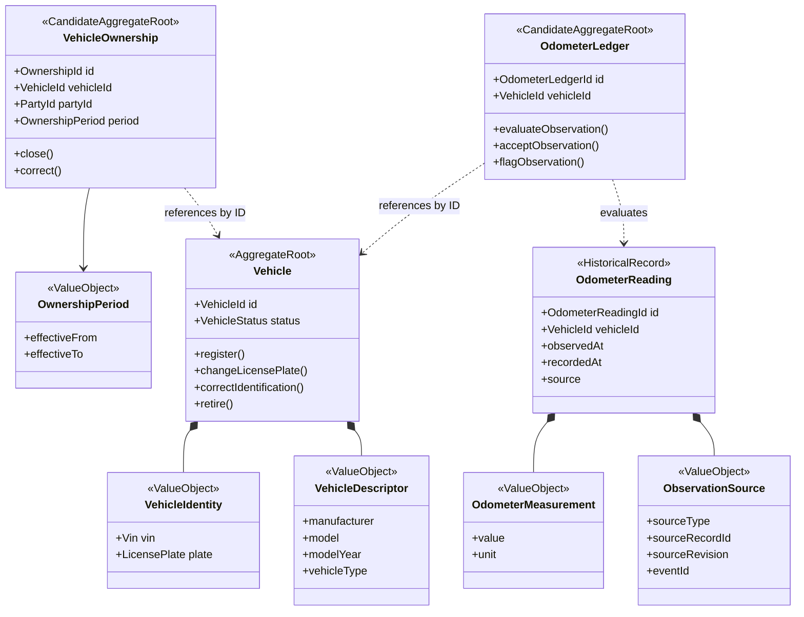
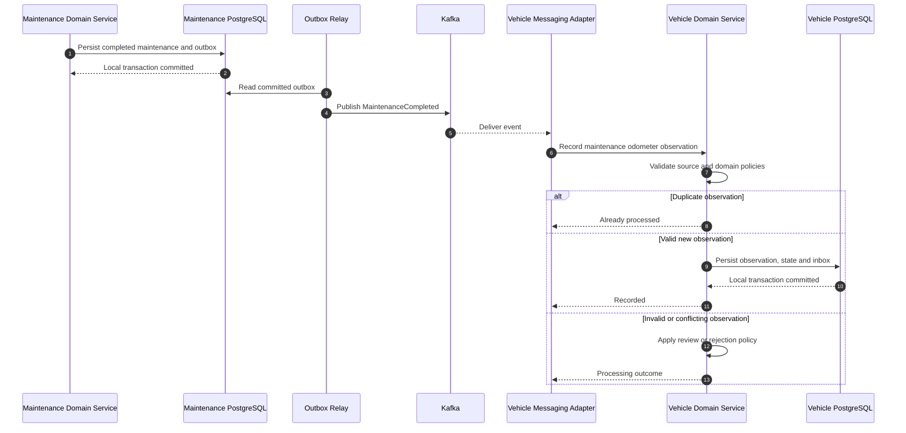

# Vehicle Registry Domain Model

**Project:** Garage Platform
**Model:** DDD Tactical Design + UML
**Version:** 0.1.0
**Status:** Draft
**Bounded Context:** Vehicle Registry

---

## 1. Purpose

This document proposes the tactical domain model
for the Vehicle Registry bounded context.

Vehicle Registry owns:

- Vehicle identity.
- Vehicle identification attributes.
- Vehicle lifecycle state.
- Vehicle ownership relationships and history.
- Authoritative odometer observations and history.

The model must preserve:

- Rich Domain Models.
- Strongly typed identifiers.
- Aggregate consistency boundaries.
- Controlled mutability.
- Independent persistence.
- Event-driven integration.
- Historical traceability.

This document does not define a final database schema
or approve all proposed aggregate boundaries.

---

## 2. Fundamental Domain Rules

### Vehicle Identity

Every vehicle MUST have a unique, immutable
system-generated VehicleId.

VehicleId MUST NOT be derived from:

- VIN.
- License plate.
- Owner identification.
- Organization.
- Vehicle model or manufacturer.

VIN and license plate are identification attributes.

They do not define the aggregate's system identity.

### Ownership

A vehicle MAY have multiple simultaneous owners.

A Party MAY own multiple vehicles.

Ownership relationships MUST be historically traceable.

A change of owner MUST NOT destroy the ownership history.

Vehicle ownership MUST NOT automatically grant
access to every historical service document.

### Odometer

Vehicle Registry owns authoritative odometer history.

Maintenance may produce odometer observations
through versioned Integration Events.

Historical observations MUST be preserved.

An old observation MUST NOT blindly replace
the current odometer state.

Odometer replacement, correction, and anomalous
readings require explicit domain policies.

### Aggregate Design

Aggregates MUST protect consistency boundaries.

A Vehicle Aggregate MUST NOT contain:

- Entire maintenance history.
- Inventory reservations.
- Appointment history.
- Every historical ownership relationship.
- Every historical odometer observation.

Business associations do not automatically imply
aggregate containment.

---

## 3. Domain Model

### Interpretation

Solid composition relationships identify
Value Objects belonging to an aggregate or record.

Dashed relationships indicate logical references
through strongly typed identifiers.

They do not require Java object references
between different aggregate roots.

VehicleOwnership and OdometerLedger are candidate
Aggregate Roots, pending validation of their
business invariants and concurrency requirements.

OdometerReading represents a historical observation.

Its final aggregate classification and persistence
design remain unresolved.

---

## 4. Vehicle Aggregate

### Responsibility

Vehicle owns its identity and lifecycle.

### Candidate Fields

- VehicleId.
- VehicleIdentity.
- VehicleDescriptor.
- VehicleStatus.
- Registration timestamp.
- Applicable lifecycle metadata.

### Candidate Behavior

    Vehicle.register(...)
    vehicle.changeLicensePlate(...)
    vehicle.correctIdentification(...)
    vehicle.retire(...)

These operations are illustrative.

Their final signatures must be designed
during implementation planning.

### Invariants

- VehicleId must be present and immutable.
- Registration must produce a structurally valid Vehicle.
- Invalid lifecycle transitions must be rejected.
- Identification changes must preserve VehicleId.
- Identification corrections must be traceable.
- Retirement must not erase historical references.

VIN availability and validation may vary
according to vehicle type and jurisdiction.

A universal 17-character VIN requirement
must not be assumed for every supported vehicle.

The global uniqueness policy for VIN values
remains unresolved.

### Mutability

Vehicle state changes through meaningful behavior.

Public setters are prohibited.

Updated Value Objects should replace
previous immutable values.

### Concurrency

Concurrent modifications must not silently
overwrite one another.

An optimistic concurrency mechanism
is a candidate implementation strategy.

The final version representation and storage
mechanism remain undecided.

---

## 5. Vehicle Identity

### VehicleId

VehicleId is a strongly typed identifier.

Conceptually:

    VehicleId extends Id<UUID>

It represents the identity of the Vehicle Aggregate.

Its value never changes because a plate, owner,
or VIN changes.

### VIN

VIN is a domain identification attribute.

The model must support cases where a VIN:

- Is temporarily unknown.
- Is absent for applicable vehicle categories.
- Requires correction.
- Follows jurisdiction-specific rules.

The exact validation policy requires further analysis.

### License Plate

LicensePlate is a Value Object.

It should account for the jurisdiction
or registration authority when relevant.

A plate may change over time.

Plate uniqueness must not be assumed globally.

### Vehicle Descriptor

A VehicleDescriptor may represent:

- Manufacturer.
- Model.
- Model year.
- Vehicle type.

Its exact composition will be validated
through registration use cases.

---

## 6. Ownership Model

### Problem

Vehicle ownership is a temporal relationship
between a vehicle and a legal or organizational party.

It is not simply a single ownerId field
inside the Vehicle Aggregate.

The platform must support:

- One owner with multiple vehicles.
- One vehicle with multiple simultaneous owners.
- Historical ownership.
- Ownership transfers.
- Corrections to historical records.
- Potentially different ownership roles.

### Candidate Aggregate

VehicleOwnership is proposed as an independent
Aggregate Root.

Candidate fields:

- OwnershipId.
- VehicleId.
- PartyId.
- OwnershipPeriod.
- Ownership role, if applicable.
- Supporting evidence reference, if applicable.
- Audit metadata.

VehicleOwnership references Vehicle
by VehicleId.

It references the owner by PartyId.

It does not embed the complete Vehicle
or Party domain object.

### Party Identity

PartyId represents an ownership subject.

A Party may eventually represent:

- A natural person.
- A legal entity.
- An organization.

PartyId must not automatically be treated
as an authenticated UserId.

The authoritative ownership and location
of Party data remain unresolved under ADR-0010.

Vehicle Registry may use an approved
external reference or local projection.

### Ownership Period

OwnershipPeriod expresses temporal validity.

Conceptually:

    effectiveFrom
    effectiveToExclusive

The exact date/time granularity remains open.

Using an exclusive end boundary can simplify
adjacent non-overlapping historical periods.

### Ownership Transfer

An ownership transfer should:

1. Identify the relevant ownership relationships.
2. Validate the requested transition.
3. Close or adjust applicable existing relationships.
4. Establish new ownership relationships.
5. Preserve historical evidence.
6. Publish relevant events when appropriate.

A transfer must not automatically close
every other owner's relationship.

Co-ownership is permitted.

### Cross-Aggregate Consistency

If VehicleOwnership is an independent Aggregate Root,
some ownership invariants may span multiple records.

Examples:

- Avoiding duplicate identical active relationships.
- Preventing incompatible overlapping assignments.
- Coordinating concurrent ownership changes.

These constraints require explicit domain-service
coordination and appropriate persistence concurrency
controls.

A repository query without concurrency protection
is not sufficient to guarantee a cross-record invariant.

If these rules require stronger aggregate-level
atomicity, the proposed boundary must be reconsidered.

---

## 7. Ownership Timeline Example

The following example illustrates simultaneous owners.

| Period | Vehicle | Party | Status |
| --- | --- | --- | --- |
| January to June | V-100 | Party A | Historical |
| April to September | V-100 | Party B | Historical |
| July onward | V-100 | Party C | Active |

The April-to-June overlap is intentional.

It represents possible co-ownership.

An owner changing does not require
replacing the VehicleId.

Historical ownership remains available
to authorized internal operations.

The table is illustrative and does not
establish final ownership share rules.

---

## 8. Odometer Domain

### Responsibility

Vehicle Registry owns the authoritative history
of odometer observations.

A reported reading is not automatically
a verified current odometer state.

### OdometerMeasurement

An immutable Value Object representing:

- Numeric value.
- Distance unit.

Candidate units:

- KM.
- MI.

Negative readings are invalid.

The numeric representation, precision,
and conversion policies must be explicit.

Conversion must not silently discard precision.

### OdometerReading

A historical observation should include:

- OdometerReadingId.
- VehicleId.
- Measurement.
- ObservedAt.
- RecordedAt.
- ObservationSource.
- Validation or acceptance state.

ObservedAt is when the measurement was taken.

RecordedAt is when Vehicle Registry persisted it.

The two timestamps must not be conflated.

### ObservationSource

The source identifies where an observation originated.

Possible sources include:

- Manual vehicle update.
- Completed maintenance record.
- Authorized inspection.
- Approved external integration.

Integration-derived observations should retain
the relevant source identifier and event metadata.

EventId supports message delivery deduplication.

Source record identity and revision support
business-level idempotency across republication
or correction events.

### OdometerLedger

OdometerLedger is a candidate Aggregate Root
responsible for evaluating and maintaining
the accepted current odometer state.

It may retain:

- VehicleId.
- Current accepted observation reference.
- Relevant measurement metadata.
- Odometer replacement or epoch information.
- Concurrency state.

It must not require every historical reading
to be loaded into memory.

Historical records may be stored separately
within the same authoritative bounded context.

The final consistency boundary must be validated
before implementation.

---

## 9. Odometer Invariants

### Historical Observations

An older observation may be recorded even when
a newer accepted observation already exists.

It must not automatically replace
the current odometer projection.

### Out-of-Order Events

Kafka event arrival order does not establish
the chronological order of measurements.

The effective observation timestamp and
domain-specific acceptance policies matter.

### Numerical Comparison

The highest numerical reading is not necessarily
the universally correct current reading.

Relevant cases include:

- Historical maintenance registration.
- Data entry errors.
- Odometer replacement.
- Odometer rollover.
- Unit conversion.
- Disputed readings.
- Corrected observations.

The model must not rely solely on max(value).

### Corrections

Corrections must retain traceability.

An existing historical observation must not
be silently rewritten without auditability.

The precise correction model remains unresolved.

### Odometer Replacement

A physical odometer replacement may create
a new measurement epoch.

The platform must distinguish a replacement
from an ordinary decrease in reported value.

Replacement policies require a separate
domain specification before implementation.

---

## 10. MaintenanceCompleted Integration

Maintenance publishes a completed business fact.

Vehicle Registry consumes the relevant observation.

The event contract must include:

- EventId.
- Contract version.
- MaintenanceId.
- VehicleId.
- Completion timestamp.
- Observed odometer value.
- Distance unit.
- Observation timestamp.

See ADR-0016 for the accepted integration decision.

### Sequence Diagram

The diagram is simplified.

When Vehicle Registry records a new integration event,
its own Outbox must participate in the relevant
local transaction.

Inbox and domain changes must be atomic
where required for idempotent business effects.

The Messaging adapter must acknowledge successful
processing according to the selected consumer strategy.

---

## 11. Example: Caleb Maintenance

Consider a vehicle registered with:

    VehicleId: vehicle-123
    Display name: Caleb
    Model: Suzuki GSX-S1000
    Model year: 2026

A maintenance operation is completed
with an odometer observation of:

    4700 KM

Maintenance publishes:

    MaintenanceCompleted

Vehicle Registry consumes the event.

The Registry:

1. Identifies vehicle-123.
2. Checks whether the observation was processed.
3. Validates the reading and source.
4. Records the historical observation.
5. Evaluates the accepted current state.
6. Commits its local transaction.
7. Optionally records VehicleOdometerRecorded.

Maintenance does not modify the vehicle database.

The vehicle Aggregate does not contain
the maintenance record.

---

## 12. Historical Maintenance Scenario

Assume Vehicle Registry currently has
an accepted reading of 4700 KM.

A historical maintenance record is registered
with an observation of 3000 KM from an earlier date.

Expected behavior:

- Preserve the historical 3000 KM observation.
- Preserve its maintenance source.
- Maintain the existing current projection
  unless a correction policy justifies a change.
- Do not reject the historical fact merely
  because its value is lower.
- Do not emit another MaintenanceCompleted event.

This avoids losing useful historical information
while protecting the current odometer state.

---

## 13. Domain Events

Candidate Vehicle Registry Domain Events include:

- VehicleRegistered.
- VehicleIdentificationChanged.
- VehicleRetired.
- VehicleOwnershipEstablished.
- VehicleOwnershipEnded.
- VehicleOdometerRecorded.
- VehicleOdometerFlagged.

These event names are proposed.

The approved cross-context integration
MaintenanceCompleted is defined by ADR-0016.

Domain Events do not automatically become
published Integration Events.

Published contracts require explicit versioning
and ownership.

Events should represent completed domain facts,
not requests to perform operations.

---

## 14. Reconstitution and Persistence

JPA entities must remain separate
from rich domain entities.

Domain aggregates must not depend on:

- JPA annotations.
- EntityManager.
- Spring Data repositories.
- Database transaction APIs.

Persistence adapters reconstruct domain
objects through controlled mechanisms.

Reconstitution must not emit new creation events.

Historical validity must be considered when
loading records written under older business rules.

Repository implementations must preserve
the relevant domain state and identity.

---

## 15. Repository Port Candidates

Candidate ports include:

    VehicleRepository
    VehicleOwnershipRepository
    OdometerHistoryRepository
    OdometerStateRepository

These are conceptual interfaces,
not approved final Java APIs.

Ports belong to:

    vehicle-domain-service/ports/repositories/

Transactions are expressed through:

    vehicle-domain-service/ports/transactions/

Repository operations must not expose
JPA entities or persistence implementation details.

Query-specific read models may use separate
application-facing ports where appropriate.

---

## 16. Transaction Boundaries

### Vehicle Registration

Vehicle registration should atomically persist:

- The Vehicle Aggregate.
- Required integration event outbox records.

Additional uniqueness constraints must be enforced
according to the approved identification policy.

### Ownership Change

Ownership changes may span multiple
VehicleOwnership records.

The coordinating use case must provide
the necessary atomicity and concurrency controls.

The proposed Aggregate Root boundaries must be
reviewed against these consistency requirements.

### Odometer Observation

Processing a maintenance-derived observation
must atomically coordinate the required:

- Historical observation recording.
- Current state updates when appropriate.
- Inbox deduplication state.
- Outbox messages when produced.

A crash must not cause partially applied
business state that violates the operation's
local consistency guarantees.

---

## 17. Authorization

Vehicle identity and legal ownership are distinct
from application access permissions.

A person may legally own a vehicle
without having an application account.

A workshop may service a vehicle
without owning the vehicle.

An owner does not automatically receive access
to every private historical document.

Authorization must be enforced by backend services.

Party references must not automatically imply
a specific identity provider or tenant model.

Public QR access must use a separate scoped
access grant and approved public projection.

---

## 18. Concurrency and Integrity

The domain must account for:

- Concurrent vehicle identification changes.
- Concurrent ownership transitions.
- Duplicate maintenance events.
- Out-of-order odometer observations.
- Concurrent manual and event-derived readings.
- Repeated corrections.
- Retried integration processing.

Potential controls include:

- Optimistic locking.
- Database uniqueness constraints.
- Vehicle-scoped transactional coordination.
- Durable Inbox.
- Domain-level transition validation.

The exact strategy must be selected
according to each invariant.

Database constraints complement domain rules.

They do not replace meaningful domain behavior.

---

## 19. Domain Testing Scenarios

### Vehicle

- Register a valid vehicle.
- Reject invalid registration information.
- Preserve VehicleId after plate changes.
- Correct identification with traceability.
- Reject invalid lifecycle transitions.
- Reconstitute without creating new events.

### Ownership

- Establish the first owner.
- Add a second simultaneous owner.
- Transfer a specific ownership relationship.
- Preserve historical relationships.
- Prevent incompatible duplicate assignments.
- Handle concurrent transitions.
- Reject invalid effective periods.

### Odometer

- Record a valid observation.
- Ignore duplicate event delivery.
- Preserve historical observations.
- Handle out-of-order arrivals.
- Flag conflicting observations.
- Process an authorized correction.
- Handle an odometer replacement.
- Preserve precision and units.
- Avoid incorrect current state regression.

### Integration

- Consume MaintenanceCompleted.
- Commit observation and Inbox atomically.
- Recover after processing failure.
- Preserve source traceability.
- Avoid circular event publication.
- Verify Outbox atomicity when producing events.

---

## 20. Aggregate Boundary Evaluation

The proposed aggregate boundaries must be reviewed
against real transactional consistency requirements.

### Vehicle

Strong candidate Aggregate Root.

Owns identity and vehicle lifecycle behavior.

### VehicleOwnership

Candidate independent Aggregate Root.

Benefits:

- Independent ownership relationship lifecycle.
- Avoids an unbounded Vehicle ownership collection.
- Supports historical traceability.

Risks:

- Cross-relationship consistency.
- Concurrent ownership transfers.
- Constraints spanning multiple records.

### OdometerLedger

Candidate Aggregate Root.

Benefits:

- Encapsulates current odometer acceptance behavior.
- Avoids loading unlimited historical observations.
- Supports focused concurrency control.

Risks:

- Synchronization with historical records.
- Odometer replacement semantics.
- Correction and review workflows.

Historical reading storage and aggregate membership
must be validated before implementation.

---

## 21. Open Decisions

1. Final ownership aggregate boundary.
2. Party identity ownership and service location.
3. VIN validation and uniqueness strategy.
4. License plate jurisdiction model.
5. Ownership roles and optional ownership shares.
6. Temporal precision for ownership periods.
7. Odometer reading numeric precision.
8. Odometer acceptance and anomaly policies.
9. Odometer replacement and correction semantics.
10. OdometerLedger aggregate implementation.
11. Read model and projection strategy.
12. Historical ownership visibility.
13. Authorization and tenant isolation model.

These questions must remain explicit.

This document must not silently convert
proposals into approved implementation requirements.

---

## 22. Related Documentation

- [Architecture Constitution](../constitution.md)
- [System Overview](../system-overview.md)
- [Bounded Context Map](02-bounded-context-map.md)
- [Backend Components](04-backend-components.md)
- [ADR-0003: Rich Domain Model](../decisions/0003-rich-domain-model.md)
- [ADR-0010: Identity and Tenancy](../decisions/0010-identity-and-tenancy.md)
- [ADR-0015: Context Boundaries](../decisions/0015-bounded-context-boundaries.md)
- [ADR-0016: Odometer Propagation](../decisions/0016-maintenance-odometer-propagation.md)

---

## Final Principle

Vehicle identity is immutable.

Ownership relationships are historical and temporal.

Odometer observations must remain traceable.

Aggregates protect their own invariants.

Cross-aggregate operations require explicit consistency
and concurrency design.

Other bounded contexts interact through approved
contracts, never through shared persistence.
