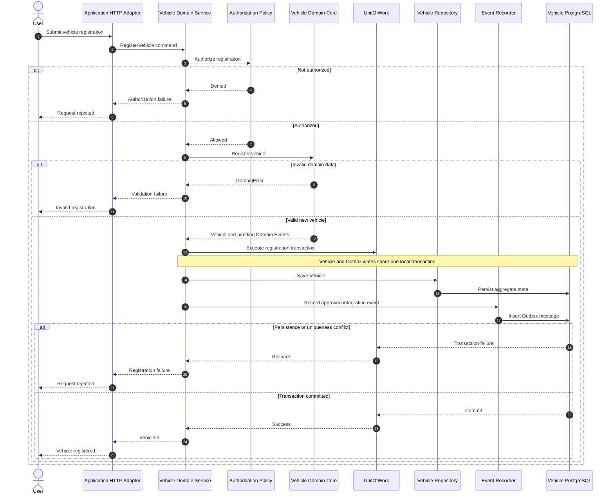
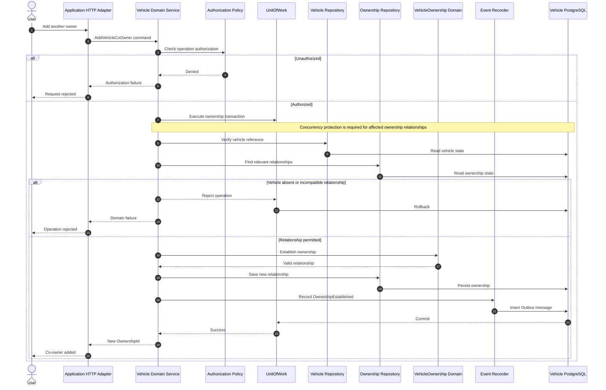
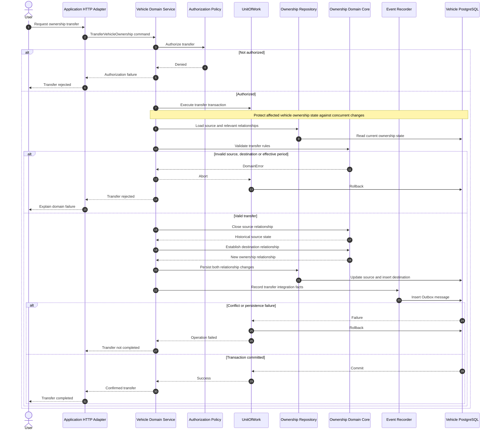
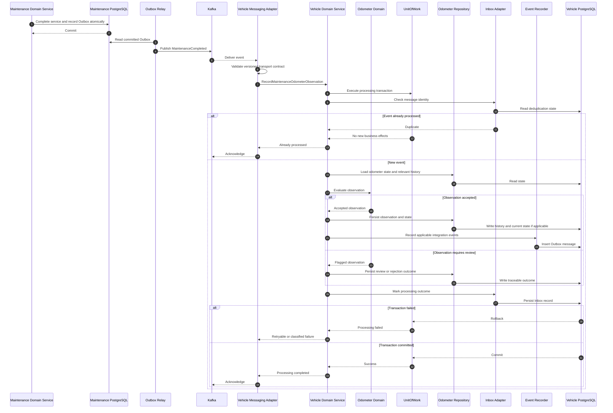

# Vehicle Registry — Use Case Sequence Diagrams

**Project:** Garage Platform
**Version:** 0.1.0
**Status:** Draft
**Bounded Context:** Vehicle Registry
**Model:** UML Sequence Diagrams

---

## 1. Purpose

This document validates the proposed Vehicle Registry
domain model through representative business workflows.

It describes:

1. Vehicle registration.
2. Adding a co-owner.
3. Transferring an ownership relationship.
4. Processing maintenance-derived odometer observations.

The diagrams distinguish:

- Transport responsibilities.
- Domain Service coordination.
- Domain Core behavior.
- Repository and transaction ports.
- Infrastructure adapters.
- Local transactional consistency.
- Asynchronous event integration.

These are logical execution diagrams.

They do not prescribe final Java method signatures,
HTTP endpoints, database tables, or event schemas.

---

## 2. Architectural Assumptions

The following decisions are already accepted:

- Domain Core owns aggregate invariants.
- Domain Service coordinates use cases.
- Ports are defined in domain-service.
- DataAccess implements repository and transaction ports.
- Outbox records events in the business transaction.
- Kafka provides asynchronous integration.
- Inbox supports durable message deduplication.
- No service modifies another service's database.
- Aggregate reconstitution does not emit creation events.

The following remain proposals:

- VehicleOwnership as an independent Aggregate Root.
- OdometerLedger as an independent Aggregate Root.
- Party identity ownership.
- Ownership transfer authorization policy.
- Vehicle-scoped concurrency implementation.
- Odometer acceptance and correction policies.

This document must not silently approve
the unresolved aggregate boundaries.

---

## 3. Common Conventions

### Application Commands

Commands express requested behavior.

Examples:

    RegisterVehicle
    AddVehicleCoOwner
    TransferVehicleOwnership
    RecordMaintenanceOdometerObservation

These are conceptual operation names.

They are not necessarily distributed
messaging commands.

### Domain Events

Domain Events express occurrences
inside the owning bounded context.

They may be recorded by aggregates.

### Integration Events

Integration Events are externally published,
versioned contracts.

An internal Domain Event must not automatically
be serialized as an Integration Event.

### Transactions

A UnitOfWork port represents the atomic operation
required by a Domain Service.

DataAccess implements the actual transaction.

All relevant business writes and Outbox writes
must participate in the same local transaction.

### Authorization

Authentication identifies the requesting principal.

Authorization determines whether that principal
may perform the requested operation.

PartyId and authenticated UserId are distinct concepts.

The exact authorization and tenancy model
remains unresolved.

---

# Use Case 01 — Register Vehicle

## 4. Business Goal

An authorized user registers a vehicle
and receives its immutable system identity.

The vehicle may be registered independently
of establishing its ownership relationships.

Initial ownership may be coordinated by
a separate authorized use case.

Registration must not assume that the
authenticated user is the legal owner.

## 4.1 Preconditions

- The caller has satisfied applicable authentication.
- The caller is authorized to register vehicles.
- Required registration data is provided.
- Identification validation rules are available.
- Vehicle identification uniqueness policies,
  where applicable, are enforceable.

The final VIN and plate uniqueness rules
remain subject to domain-specific decisions.

## 4.2 Sequence Diagram

## 4.3 Invariants

- VehicleId is generated independently of VIN and plate.
- VehicleId is immutable.
- Registration must create a structurally valid Vehicle.
- Vehicle registration must not create unrestricted
  access to the vehicle's private information.
- Persistence failures must not leave an incomplete
  Vehicle and Outbox transaction.
- Reconstitution must not reproduce registration events.

## 4.4 Transaction Boundary

The local transaction includes:

1. Vehicle persistence.
2. Required Outbox recording.

Outbox publication to Kafka occurs after
successful transaction commitment.

The HTTP request does not need to wait
for Kafka delivery.

## 4.5 Failure and Concurrency Cases

- Invalid vehicle information.
- Authorization denied.
- Duplicate registration request.
- Conflicting identification information.
- Concurrent registrations using the same
  identification attribute.
- Database transaction failure.
- Outbox persistence failure.

Application-level uniqueness checks alone
are insufficient when uniqueness must be
guaranteed under concurrency.

Database constraints or equivalent
transactional controls are required.

Duplicate request idempotency requirements
must be specified before final implementation.

---

# Use Case 02 — Add Vehicle Co-Owner

## 5. Business Goal

An authorized operation establishes an
additional ownership relationship without
removing existing compatible relationships.

Vehicle ownership is many-to-many over time.

A vehicle may have multiple simultaneous owners.

## 5.1 Preconditions

- The vehicle exists.
- The requesting principal is authorized.
- The proposed PartyId is valid under
  the applicable identity policy.
- The effective ownership period is valid.
- The proposed relationship does not violate
  approved ownership constraints.

Party existence and validation must follow
approved integration contracts if Party data
is owned outside Vehicle Registry.

A direct query into another service's
database is forbidden.

## 5.2 Sequence Diagram

## 5.3 Critical Invariants

- Existing compatible co-owners remain unchanged.
- A new relationship must preserve the VehicleId.
- Ownership must be traceable to a PartyId.
- An invalid ownership period must be rejected.
- Duplicate or incompatible relationships must
  be handled according to explicit domain policies.
- The same operation must not produce uncontrolled
  duplicate relationships under concurrent execution.

## 5.4 Concurrency Considerations

If VehicleOwnership is an independent Aggregate Root,
consistency rules spanning multiple ownership records
require special attention.

A simple query followed by an insert
does not prevent all concurrent conflicts.

Candidate mechanisms include:

- Vehicle-scoped serialized operations.
- Explicit transactional locking.
- Database uniqueness or exclusion constraints.
- Optimistic concurrency with safe retries.

The final mechanism remains undecided.

The design must prove correctness for concurrent
requests involving the same vehicle and PartyId.

## 5.5 Important Clarification

Adding a co-owner does not mean:

    Close every existing ownership relationship.

It means:

    Establish a new compatible ownership relationship.

Historical and concurrent ownership records
must be preserved.

---

# Use Case 03 — Transfer Vehicle Ownership

## 6. Business Goal

An authorized operation ends a specific
existing ownership relationship and establishes
a new relationship with another Party.

Other compatible co-owners must remain unchanged.

The operation must preserve the historical record.

## 6.1 Proposed Command

Conceptually:

    TransferVehicleOwnership
        vehicleId
        sourceOwnershipId
        destinationPartyId
        effectiveAt
        requestedBy
        operationId

The final command shape remains undecided.

The operationId is a candidate mechanism
for command-level idempotency.

The authenticated principal is not automatically
the source or destination owner.

## 6.2 Sequence Diagram

## 6.3 Atomicity Requirement

The transaction must guarantee:

- The source relationship is closed.
- The destination relationship is established.
- Required Outbox records are persisted.

Either all applicable changes commit
or none of them do.

A failed transfer must not produce
a partially transferred vehicle.

## 6.4 Temporal Model

An ownership relationship may use:

    effectiveFrom
    effectiveToExclusive

A transfer at time T may produce:

    Source relationship:
        effectiveToExclusive = T

    Destination relationship:
        effectiveFrom = T

Existing unrelated co-owner relationships
must not be automatically modified.

The final temporal precision and policies
for future-dated or retroactive transfers
remain unresolved.

## 6.5 Example with Co-Owners

Before transfer:

    Vehicle V-100

    Party A: Active
    Party B: Active
    Party C: Active

Party B transfers its relationship to Party D.

After transfer:

    Party A: Active
    Party B: Historical
    Party C: Active
    Party D: Active

The operation preserves:

- Vehicle identity.
- Party A's relationship.
- Party C's relationship.
- Historical information for Party B.

It does not overwrite all owners
with a single destination PartyId.

## 6.6 Concurrency Cases

The implementation must handle:

- Two simultaneous transfers of the same source.
- Transfer while another relationship is added.
- Transfer of an already closed relationship.
- Repeated submission of the same transfer.
- Target Party already having an active relationship.
- Transfer with an invalid effective timestamp.
- Concurrent correction of historical ownership.

These cases may challenge the proposed
independent VehicleOwnership Aggregate Root boundary.

The boundary must be revisited if atomic
cross-record rules cannot be enforced cleanly.

## 6.7 External Authorization

An ownership transfer may require evidence
or approval in future business workflows.

This document does not assume that a single
authenticated owner may unilaterally transfer
every legal ownership relationship.

Authorization, evidence, consent, and
approval policies remain open domain decisions.

---

# Use Case 04 — Process MaintenanceCompleted

## 7. Business Goal

When Maintenance completes a service,
Vehicle Registry receives an asynchronous
Integration Event containing the observed
odometer reading.

Vehicle Registry evaluates the observation
and updates its authoritative history.

The maintenance record itself remains
owned by Maintenance.

This integration is defined by ADR-0016.

## 7.1 Event Information

The versioned Integration Event includes:

- EventId.
- MaintenanceId.
- VehicleId.
- Completion timestamp.
- Odometer value.
- Distance unit.
- Observation timestamp.
- Contract version.

A source revision or equivalent business
version may be introduced if required by
the approved correction and publication model.

The complete Maintenance Aggregate
must not be transported.

## 7.2 Sequence Diagram

## 7.3 Responsibilities

### Maintenance

Maintenance owns:

- Completed maintenance records.
- Observed service odometer information.
- Its own Outbox messages.
- Publication of MaintenanceCompleted.

Maintenance must not update
Vehicle Registry's database.

### Kafka and Outbox

Kafka transports approved Integration Events.

Outbox makes committed events available
for reliable asynchronous publication.

Publication may occur after the original
HTTP request has completed.

### Vehicle Messaging Adapter

The Messaging adapter:

- Receives the message.
- Validates the transport contract.
- Maps the event into an application command.
- Calls the appropriate Domain Service.
- Handles technical acknowledgment and failures.

It must not implement odometer
acceptance business rules.

### Vehicle Domain Service

Domain Service:

- Coordinates message idempotency.
- Loads the relevant domain state.
- Invokes odometer domain behavior.
- Defines the local transaction boundary.
- Persists business outcomes through ports.
- Records outgoing integration events when required.

### Odometer Domain

Odometer domain behavior:

- Evaluates the reading.
- Applies approved acceptance policies.
- Protects current state consistency.
- Distinguishes observations from current state.
- Handles relevant historical and anomaly semantics.

The final OdometerLedger Aggregate Root
boundary remains a proposal.

---

## 8. Event Idempotency

Kafka may redeliver the same Integration Event.

The consumer must avoid duplicating business effects.

Technical message deduplication may use EventId.

Business-level idempotency should also consider
the originating maintenance record identity
and any approved revision identifier.

A newly published event with a different EventId
must not automatically create a second logical
observation if it represents the same source fact.

Uniqueness and transaction controls are required
to handle concurrent duplicate deliveries.

An Inbox record and its associated business effects
must be atomic when needed for correctness.

---

## 9. Odometer Observation Scenarios

| Scenario | Expected Behavior |
| --- | --- |
| Valid recent observation | Record and evaluate current state |
| Duplicate event | Do not duplicate business effects |
| Historical maintenance observation | Preserve history without blind current-state regression |
| Out-of-order delivery | Evaluate using observation semantics |
| Invalid negative reading | Reject or quarantine according to policy |
| Conflicting source observation | Preserve traceable conflict outcome |
| Physical odometer replacement | Apply explicit replacement policy |
| Vehicle not found | Apply defined retry or reconciliation policy |
| Temporary database failure | Roll back and retry safely |

The final business policies for rejection,
review, and correction remain unresolved.

The system must not silently acknowledge
unprocessed events without a durable,
defined disposition.

---

## 10. Historical Observation Example

Assume Vehicle Registry currently has:

    VehicleId: vehicle-123
    Current accepted reading: 4700 KM

A historical maintenance is registered with:

    Observed reading: 3000 KM
    ObservedAt: Earlier date

Expected outcome:

1. The event is received and deduplicated.
2. The observation source is preserved.
3. The historical reading is recorded.
4. The current accepted reading is evaluated.
5. The current state is not blindly reduced
   from 4700 KM to 3000 KM.

This preserves history without treating
Kafka arrival time as measurement time.

---

## 11. Current State Versus Historical Observation

A recorded observation and the vehicle's
current odometer projection are different concepts.

A historical observation may be legitimate
without becoming the current state.

A high numeric reading may also be invalid
or belong to a different odometer epoch.

The current-state policy must consider:

- Observation timestamps.
- Recorded timestamps.
- Distance units.
- Verified corrections.
- Physical odometer changes.
- Potential data-entry mistakes.
- Domain confidence or review status.

Using max(value) as the universal selection
algorithm is prohibited without an explicitly
approved domain policy.

---

## 12. Outgoing Odometer Events

Vehicle Registry may publish:

    VehicleOdometerRecorded

after successfully recording an observation.

A distinct event may eventually represent
a change to the accepted current reading.

Event naming and publication semantics
must be finalized before contract implementation.

Maintenance may consume approved odometer
events when recalculating preventive plans.

That consumer must not create an infinite
event publication loop.

Receiving VehicleOdometerRecorded must not
produce another MaintenanceCompleted event.

---

## 13. Transactional Guarantees

### Vehicle Registration

Vehicle persistence and required Outbox records
must commit atomically.

### Ownership Changes

All ownership records affected by a locally
atomic operation must commit together.

### Maintenance Event Consumption

The relevant odometer state, historical records,
Inbox processing state, and applicable Outbox
messages must use one local transaction.

### Kafka Publication

Kafka publication is not part of an ordinary
PostgreSQL local transaction.

The Outbox mechanism provides reliable
post-commit publication.

### Cross-Service Consistency

Maintenance and Vehicle Registry are
eventually consistent.

No global database transaction is required
for odometer propagation.

A Saga is not required merely because
MaintenanceCompleted triggers an observation.

---

## 14. Failure Recovery

Failure handling must distinguish:

### Domain Rejection

The requested behavior violates a domain rule.

The application must communicate a meaningful
failure or persist a defined review outcome.

### Concurrency Conflict

Concurrent operations prevent the requested
transition from being safely committed.

A controlled retry may be appropriate.

Retries must not discard authorization
or domain validation.

### Infrastructure Failure

Examples include:

- Database unavailable.
- Kafka consumer interrupted.
- Transaction commit failure.
- Outbox relay unavailable.

The system must preserve atomicity
and support safe recovery.

### Permanent Contract Failure

An invalid or unsupported event contract
requires an explicit non-retryable handling
or dead-letter strategy.

It must not be silently discarded.

---

## 15. Required Integration Tests

### Vehicle Registration

- Valid registration commits.
- Invalid registration fails.
- Outbox and aggregate persistence are atomic.
- Concurrent uniqueness conflicts are handled.
- Reconstitution does not emit registration events.

### Co-Ownership

- New co-owner can be established.
- Existing compatible owners remain active.
- Duplicate compatible requests are handled safely.
- Invalid ownership periods are rejected.
- Concurrent conflicting assignments are controlled.

### Ownership Transfer

- Source relationship is closed.
- Destination relationship is established.
- Other co-owners remain unchanged.
- Historical relationships remain traceable.
- Failed transactions roll back all changes.
- Concurrent transfer conflicts are handled.
- Repeated command execution is idempotent
  if the approved command contract requires it.

### Maintenance Odometer Propagation

- MaintenanceCompleted is consumed correctly.
- Message delivery can be repeated safely.
- Historical readings do not blindly regress current state.
- Out-of-order delivery is handled.
- Observation source is retained.
- Invalid observations produce defined outcomes.
- Inbox and business state commit atomically.
- Outbox writes are atomic when applicable.
- Infrastructure failures are recoverable.
- No circular event publication occurs.

---

## 16. Architecture Validation

The implementation must demonstrate:

- HTTP adapters do not own business rules.
- Kafka listeners do not own odometer rules.
- Domain Service coordinates transactions.
- Domain Core enforces aggregate invariants.
- DataAccess implements repositories.
- Outbox does not publish inside an uncommitted
  business transaction.
- Repository ports expose domain models,
  not JPA implementation types.
- No service accesses another service's database.
- Aggregate boundaries satisfy actual
  transactional consistency requirements.

The dependency graph must remain acyclic.

ArchUnit and Maven dependency tests should
verify applicable backend restrictions.

---

## 17. Aggregate Boundary Assessment

### Vehicle

The proposed boundary is suitable for
identity and lifecycle behavior.

Ownership and odometer histories are not
embedded as unlimited collections.

### VehicleOwnership

The proposed independent Aggregate Root
requires further validation.

The main concern is consistency across
multiple ownership relationships.

Transfer and co-ownership scenarios require
transactional and concurrency controls
beyond isolated entity validation.

### OdometerLedger

The proposed Aggregate Root appears useful
for controlling accepted odometer state.

Its exact relationship to historical
observation storage must be evaluated.

A ledger must not require loading an
unbounded historical collection.

A current-state projection must remain
consistent with the approved observation policy.

---

## 18. Open Decisions

1. Ownership transfer approval and evidence.
2. Ownership relationship uniqueness semantics.
3. Ownership concurrency strategy.
4. Future-dated and retroactive transfers.
5. Party identity ownership.
6. Vehicle registration uniqueness policies.
7. Registration command idempotency.
8. Odometer observation acceptance rules.
9. Odometer correction and replacement policies.
10. Odometer current-state selection algorithm.
11. Event schema and revision strategy.
12. Consumer failure classification.
13. Final VehicleOwnership aggregate boundary.
14. Final OdometerLedger aggregate boundary.

These are domain design questions.

They must not be silently resolved through
infrastructure implementation choices.

---

## 19. Related Documentation

- [Architecture Constitution](../constitution.md)
- [Bounded Context Map](02-bounded-context-map.md)
- [Backend Components](04-backend-components.md)
- [Vehicle Domain Model](06-vehicle-domain-model.md)
- [ADR-0003: Rich Domain Model](../decisions/0003-rich-domain-model.md)
- [ADR-0005: Outbox and Inbox](../decisions/0005-transactional-outbox-inbox.md)
- [ADR-0006: Saga Coordination](../decisions/0006-saga-coordination.md)
- [ADR-0015: Bounded Context Boundaries](../decisions/0015-bounded-context-boundaries.md)
- [ADR-0016: Odometer Propagation](../decisions/0016-maintenance-odometer-propagation.md)

---

## Final Principle

Business operations must remain correct
under concurrency, retries, partial failure,
and asynchronous event delivery.

Aggregate boundaries are justified
by the invariants they protect.

Transaction boundaries must be explicit.

Integration events communicate completed facts.

Infrastructure must support domain consistency,
not substitute for it.
