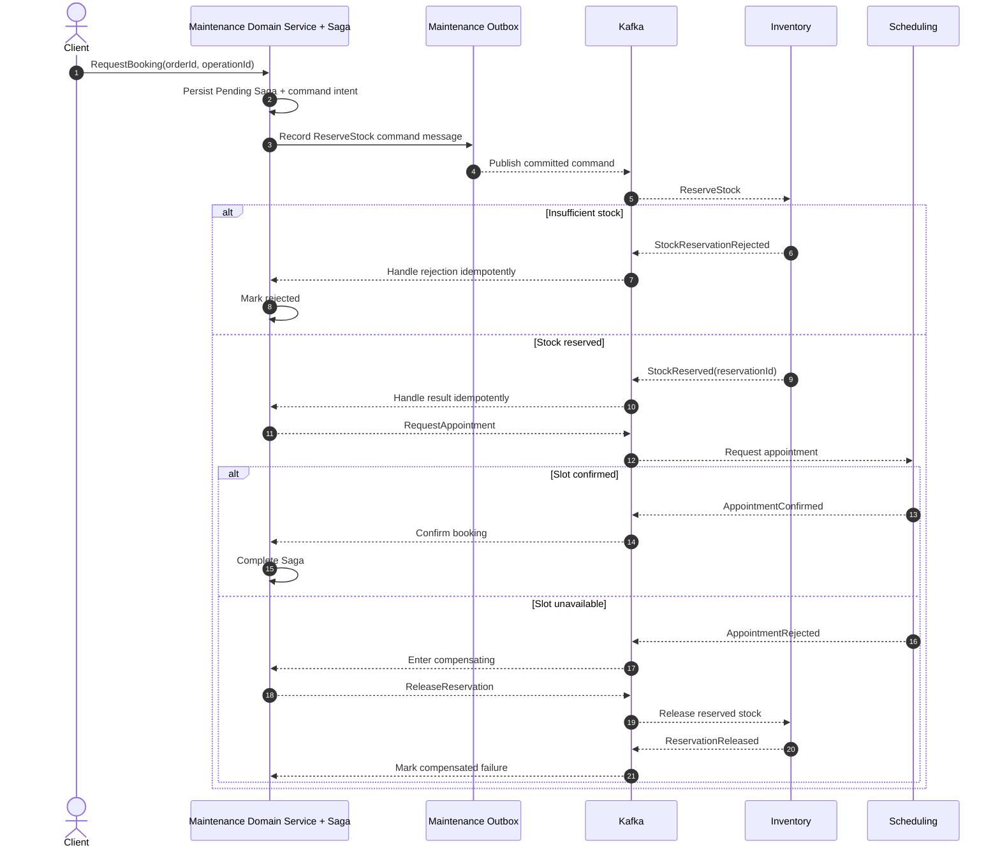

# Maintenance Booking - Proposed Saga Sequence and Failure Paths

**Status:** Draft - pending product/architecture review  
**Version:** 0.1.0  
**Prepared:** 2026-10-26

## Status
This is an **illustrative Saga candidate**. Not every maintenance order needs stock or an appointment. Business workflow and compensation policy must be ratified (OD-010/015).

## Invariants and timeouts
Saga state and outgoing messages must be durable. Duplicate responses must not repeat effects. Late confirmations after timeout require reconciliation. Never mark the booking confirmed before both required conditions hold. Failed release must remain in `REQUIRES_INTERVENTION`, not silently disappear.

## Domain boundaries
Maintenance owns overall service booking decision; Inventory owns stock correctness; Scheduling owns appointment capacity. Saga commands are not completed business events. Outbox/Inbox support reliable messaging but do not replace Saga.
