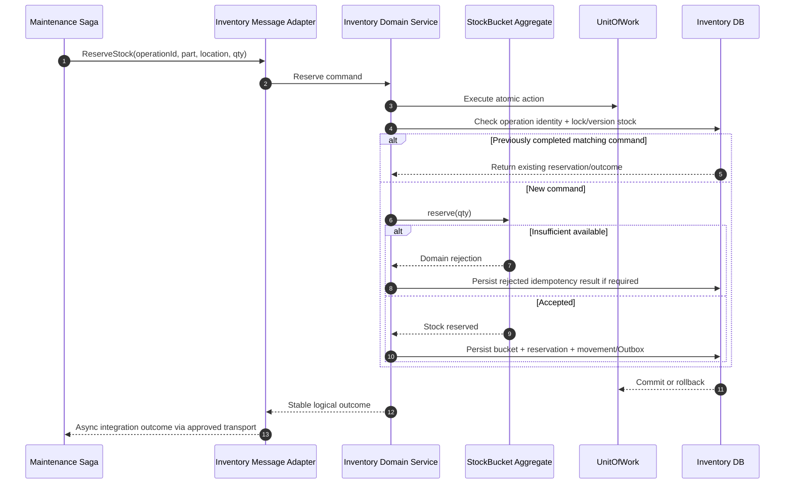

# Inventory - Reservation and Consumption Sequence

**Status:** Draft - pending product/architecture review  
**Version:** 0.1.0  
**Prepared:** 2026-10-26

## Scope
Demonstrate local atomicity, concurrency and business idempotency for proposed Inventory aggregates.

## Critical parallel scenario
With onHand=3 and reserved=0, two concurrent requests for 2 units cannot both succeed without new supply. A read/modify/write sequence without locking/versioned constraint is insufficient. When consumed, decrease both onHand and reserved exactly once; releasing consumed stock is invalid.

## Tests
Parallel reservations, duplicate operation IDs with same/conflicting body, release twice, late release after consume, negative adjustment attempt, reservation expiry, missing part/location, DB rollback before Outbox and consumer replay after ack loss.
