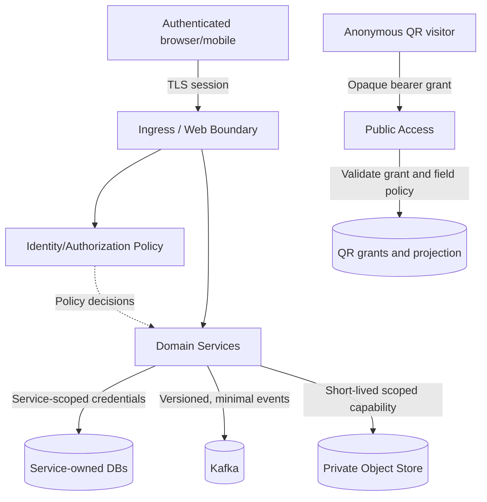

# Security Trust Boundaries and Sensitive Data Flows

**Status:** Draft - pending product/architecture review  
**Version:** 0.1.0  
**Prepared:** 2026-10-26

## Logical trust model

Public bearer grants are not user sessions; a VehicleId or VIN is not an authorization token. Each protected backend operation must validate principal, organization, resource and scope.

## Sensitive flows
- Full owner evidence: restricted source, never QR or Kafka default.
- Private workshop notes: authorized record owner only; not implicitly available on vehicle transfer.
- Maintenance summary: may be selectively projected with explicit data contract.
- Media URL: short-lived bearer; avoid logs/referrers and content served from privileged app origin.
- Outbox/event schema: no raw QR tokens or personal documents.

## Abuse-case test suite
Foreign VehicleId enumeration, cross-tenant cache leak after org switch, QR revoked but still cached, signed media URL after rights revoked, workshop B unauthorized access to workshop A's document, forged Kafka event and over-privileged support account.
