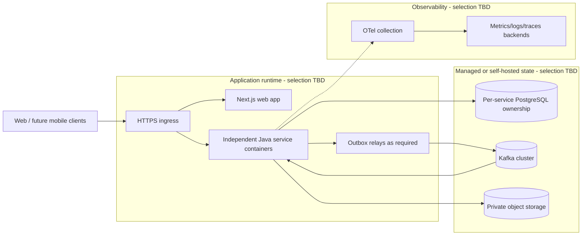

# Deployment Alternatives - C4-Style View

**Status:** Draft - pending product/architecture review  
**Version:** 0.1.0  
**Prepared:** 2026-10-26

## Purpose
Visualize deployment responsibilities without deciding host, cloud provider or orchestrator. ADR-0013 remains Draft.

## Decisions to approve
Runtime: Compose/managed/Kubernetes; physical PostgreSQL topology vs logical ownership; Kafka brokers/retention; media object storage; secrets/TLS/network; image registry; telemetry backend; multi-zone/high availability; backup/restore objectives and cost.

## Verification
Independent service deployment, isolated DB credentials, no cross-service schema access, no public DB/Kafka ports, safe migration sequencing, replayability of committed Outbox and environment-separated credentials.
