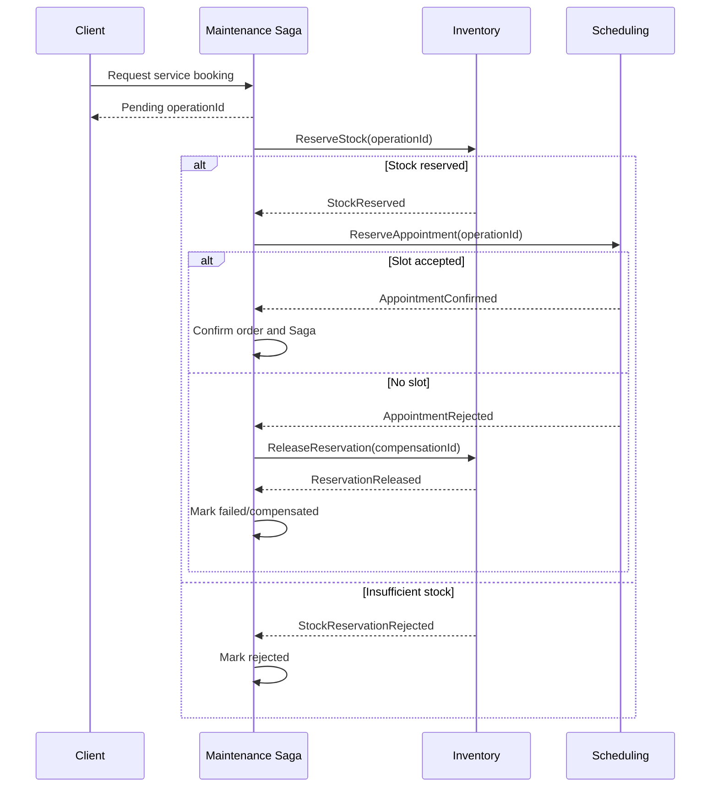

# Cross-Context Workflow Catalog and Coordination

**Status:** Draft - pending product/architecture review  
**Version:** 0.1.0  
**Prepared:** 2026-10-26

## Classification
Use *asynchronous event reaction* when a completed fact causes independent downstream work. Use *Saga* when an owning business process requires several dependent local operations and potential compensation. Outbox/Inbox provide reliable transport and deduplication, **not** business orchestration.

| Workflow | Owner | Pattern | Current decision |
| --- | --- | --- | --- |
| Maintenance completion → odometer history | Maintenance publishes; Registry consumes | Asynchronous event | Accepted ADR-0016; **no Saga required** |
| Vehicle facts → QR public projection | Registry/Public Access | Asynchronous projection + authorization | Proposal |
| Maintenance summary → QR projection | Maintenance/Public Access | Asynchronous sanitized projection | Proposal |
| Maintenance due → reminder | Maintenance/Notifications | Asynchronous event + notification idempotency | Proposal |
| Maintenance booking needing parts + slot | Maintenance | Saga orchestration candidate | To decide OD-010/015 |
| Stock reservation → consumption | Inventory | Local state machine + async outcome | Proposal |
| Owner transfer → rights review | Registry/Auth/Public Access | Event-triggered policy reevaluation | Proposal |

## Proposed maintenance booking Saga

Every outgoing command and incoming outcome must be durable/idempotent; `operationId` links outcomes. Timeouts, late responses, failed compensation and manual intervention require explicit policy.

## Compensation rules
Release a stock reservation if it is not consumed. Cancel an appointment if customer booking cannot be confirmed. Do not call compensation a technical rollback; some real-world actions are irreversible and require exception handling.

## Operational workflow states
`PENDING`, `WAITING_FOR_STOCK`, `WAITING_FOR_APPOINTMENT`, `CONFIRMED`, `COMPENSATING`, `CANCELLED`, `FAILED`, `REQUIRES_INTERVENTION` are candidates. Business order lifecycle and technical Saga state must remain distinct.

## Distinct maintenance-odometer pathway
A completed owner/workshop service commits in Maintenance immediately. Delayed Registry event processing does not undo completed service; Registry records/flags observation and may emit a separate `VehicleOdometerRecorded` fact. Avoid feedback loops.

## Review gate
Per workflow define initiator, business owner, success predicates, step dependencies, local transactions, timeouts, command/event contracts, retries, compensation ownership, visibility, recovery runbook and tests.
