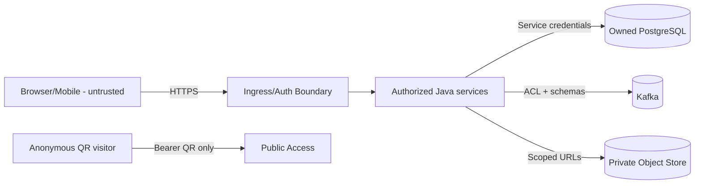

# Threat Model - Garage Platform

**Status:** Draft - pending product/architecture review  
**Version:** 0.1.0  
**Prepared:** 2026-10-26

## Assets and trust boundaries
Protected assets: authenticated session, legal ownership, private service history, organization membership, inventory transactions, appointment capacity, public QR grants, vehicle documents, Kafka payloads, DB/backup encryption keys, audit records.

## Threat register
| Threat | Entry point | Impact | Proposed mitigation |
| --- | --- | --- | --- |
| IDOR across vehicles | VehicleId in API path | Private data leak | Server resource authorization, deny by default |
| Tenant-crossing query | Missing org predicate | Customer data leak | Service policy + DB isolation defense |
| Token enumeration | Predictable QR URL | Public data scraped | Random grant, digest, rate limit |
| QR token leakage | Referrer/log/analytics | Unauthorized limited view | Referrer/cache policy, redacted logs, rotation |
| Role escalation | Membership API | Stock/records tampering | Scope authorization, admin approval, audit |
| Duplicate stock commands | Kafka replay/API retry | Over-reservation | Command identity + transactional dedup |
| Event spoof/replay | Broker topic access | False maintenance/odometer | Topic ACL, schema/auth, source idempotency |
| Unauthorized media read | Signed URL reuse | Documents exposed | Short TTL, scope, private storage |
| Injection/malicious upload | Files/inputs | Server/client compromise | Type/content scanning, output escaping |
| Lost audit | DB updates | Fraud/untraceable changes | Append-only audit/provenance, controlled access |
| Secret leakage | CI/runtime/telemetry | Environment compromise | Vault/secret manager, log redaction, rotation |
| Backup exfiltration | Storage admin | Bulk personal data | Encryption, least privilege, restore audit |
| Dependency supply chain | Build pipeline | Compromised artifacts | Pin/verify deps, scanning, provenance |
| Denial of service | Public API/QR | Availability loss | Rate limits, quotas, backpressure |

## Abuse cases
1. Workshop B guesses VIN and fetches Workshop A invoice.
2. Former member uses still-valid access token after membership revoked.
3. Public QR token appears in observability logs and is replayed.
4. Owner transfer is used to gain access to all historical private documents.
5. Duplicate Kafka command consumes parts twice.
6. Admin uploads HTML/SVG that executes in a privileged origin.
7. Backup restore resurrects revoked QR grants without proper reconciliation.

## Required verification
Authorization integration tests per resource; token entropy/revoke/rotate tests; cross-tenant adversarial test; attachment scanning and signed-read tests; Kafka producer/consumer topic ACL audit; chaos/failure tests for Outbox/Inbox; privacy inspection of logs/traces.

## Open dependencies
Actual hosting, jurisdictions, OIDC implementation, tenant persistence, authentication/session approach, threat ownership and incident response escalation require approval. Review after every externally visible capability change.
