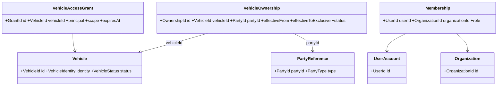

# Vehicle Identity, Party, and Historical Ownership Model

**Status:** Draft - pending product/architecture review  
**Version:** 0.1.0  
**Prepared:** 2026-10-26

## Central distinction
`VehicleId` identifies the vehicle in the system. `PartyId` identifies the subject associated with ownership. `UserId` identifies a login. `OrganizationId` identifies a workshop/fleet unit. `VehicleAccessGrantId` identifies a permission. Never collapse these identifiers.

## Candidate conceptual model

These are conceptual relationships, not final module ownership or JPA mapping.

## Required invariants
- Co-ownership: multiple active ownership relationships can exist for one VehicleId.
- Transfer a *specific* OwnershipId and preserve other co-owners.
- Use effective periods for audit; historic records are not deleted by normal transfer.
- A VIN/plate correction does not change VehicleId.
- User authorization is determined by explicit policy and grants, not by merely knowing PartyId.
- A workshop that performed a service may retain its own business record but cannot automatically disclose another workshop's private data.

## Authorization hypothesis (requires ratification)
Use a principal+resource+scope policy layer with grants for `vehicle:view`, `vehicle:manage`, `maintenance:read`, `maintenance:write`, `ownership:propose`, `qr:manage`; each request checks current policy and organization membership. Being listed as a legal owner may be an input to eligibility, never the sole technical authority without identity binding.

## Transfer concurrency
Candidate transaction: lock or otherwise serialize the vehicle's affected ownership set, validate source active, close source period, create destination relationship, record audit and Outbox as one local ACID operation. Simultaneous transfer requests must deterministically conflict or deduplicate. An independent VehicleOwnership Aggregate Root does not eliminate set-wide consistency requirements.

## Open policy cases
- Proven legal title vs self-reported ownership; required evidence.
- Transfer with multiple shares and percentage interests.
- Backdated transfers, corrections and overlapping periods.
- Non-person Party, deceased owner, importer/temporary vehicle.
- Access to prior maintenance records after transfer.
- Cross-tenant Vehicle identity versus scoped copies (OD-003).
- Personal data retention under applicable law.

## Decision checkpoint
Approve authoritative source of Party, accepted entity/aggregate boundaries, title-verification process, time precision, permission policy and consistency mechanism before implementing the registry.
