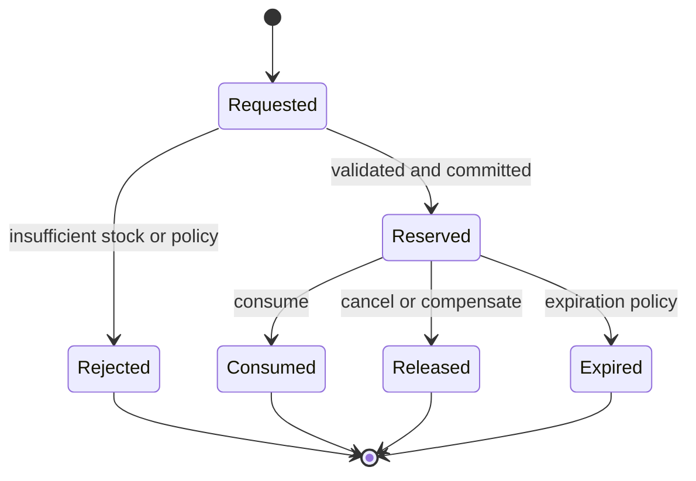

# Inventory Reservations - Concurrency and Consistency

**Status:** Draft - pending product/architecture review  
**Version:** 0.1.0  
**Prepared:** 2026-10-26

## Proposed quantity model
For a Part at one location, maintain `onHand >= 0`, `reserved >= 0`, and `reserved <= onHand` unless an explicitly approved exceptional state exists. An available quantity is derived from a **consistent** snapshot, not a stale UI number.

## Reservation lifecycle

Expiration is a business event with audit. Do not release a previously consumed reservation.

## Atomic operations
**Reserve:** validate positive quantity and scope, ensure available, create reservation, increment reserved, write Outbox in one local transaction. **Release:** require valid state, decrement reserved once, record outcome. **Consume:** require Reserved, decrement both onHand/reserved once, record movement and consumed result atomically.

## Concurrency strategy candidates
1. **Optimistic versioning** on StockBucket plus bounded retries.
2. **Pessimistic row lock** by (partId, locationId) for stock changes.
3. **Single-writer serialized partitioning** with durable command dedup.
Avoid check-then-write without concurrency control. Tests must establish no oversell under simultaneous requests; select one strategy with evidence before implementation.

## Idempotency
`operationId` represents a business command. Repeating an operationId with identical parameters returns its previous outcome; repeating with conflicting parameters is an error. Source event IDs alone are inadequate when the same logical command is republished.

## Async workflow
Maintenance sends ReserveStock → Inventory emits StockReserved/Rejected → Saga decides whether to proceed to scheduling or request release. Reservations and appointments are **not** a shared DB transaction.

## Required edge cases
Partial stock, substitute parts, unit conversion, expiry, multiple locations, cancellation in flight, provider downtime, repeated compensation, negative adjustments, stock count corrections and legacy reservation recovery. Their V1 availability must be approved.
