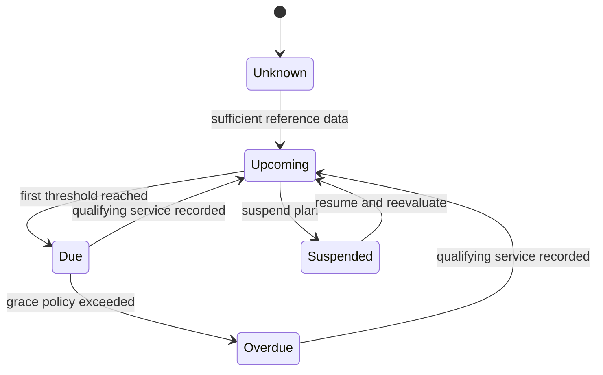

# Preventive Maintenance - Policy and Due Calculation Design

**Status:** Draft - pending product/architecture review  
**Version:** 0.1.0  
**Prepared:** 2026-10-26

## Inputs
- `VehicleId`, `PlanId`, maintenance category/service definition.
- Last qualifying completion's **effective service time** and attributed odometer (if known).
- Time interval (calendar duration, not assumed fixed days for every month).
- Distance interval and unit.
- Current evaluated odometer/observation freshness from Vehicle Registry.
- Plan activation/suspension and applicable override history.

## Candidate decision rule - REQUIRES APPROVAL (OD-007)
For plans with both time and distance intervals, proposed default is **due on the first reached threshold** (`timeDue OR distanceDue`). A plan with only one threshold uses that one. Where a base reading is unknown, show `DISTANCE_UNKNOWN` rather than inventing a due mileage. Represent `UPCOMING`, `DUE`, `OVERDUE`, `UNKNOWN`, `SUSPENDED` with explicit timestamp and reasons.

## Calculation examples (illustrative only)
- Last service at 4,700 KM, distance interval 5,000 KM -> candidate next threshold 9,700 KM.
- Last service on 2026-10-25, calendar interval 6 months -> candidate next date 2027-04-25 (calendar arithmetic, time zone defined by plan policy).
- If one threshold is met and another is not, OR policy yields due; never silently choose AND.
- If a reading from 2025 arrives after a later 2026 accepted reading, preserve history and reevaluate only with a defined source ordering/plan rule.

## State transitions

Whether `Overdue` requires a grace period is TBD. `Unknown` must not mean 'not due'.

## Events and idempotency
Due events must identify `planId`, `vehicleId`, due-condition fingerprint/version, evaluatedAt, due reasons and effective threshold. Notifications deduplicates by meaningful reminder identity, not Kafka event ID alone. Recalculation must not create an infinite Maintenance/Registry event loop.

## Test cases
Leap dates, month boundaries, timezones, changed unit, missing mileage, suspended plan, replacement odometer epoch, duplicated completion, corrected service date, stale projection, early service, delayed Kafka event, and multiple matching maintenance categories.
