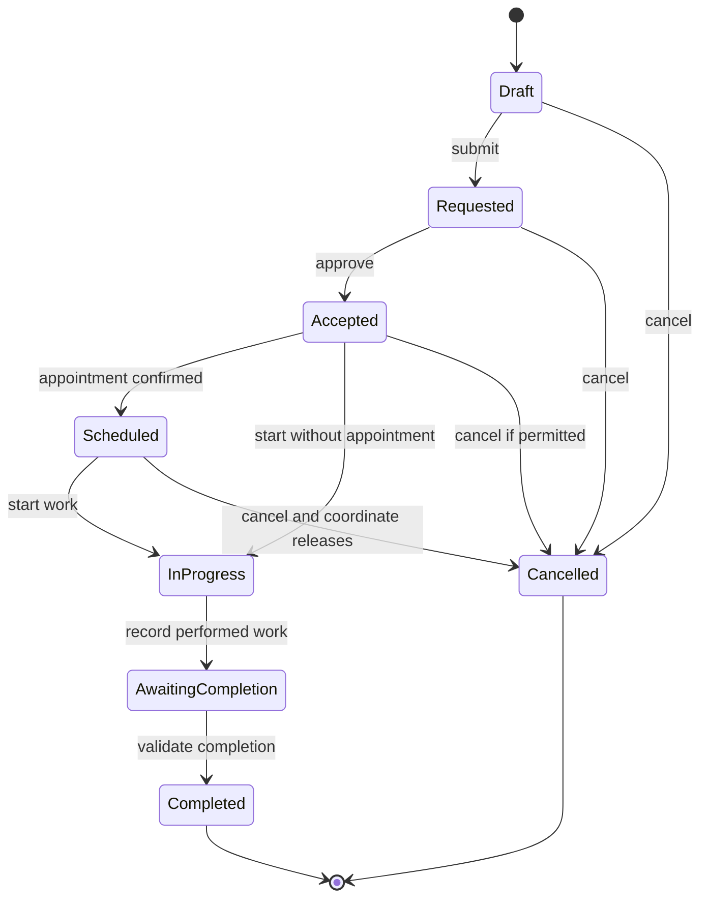

# Maintenance Orders and Records - Lifecycle State Models

**Status:** Draft - pending product/architecture review  
**Version:** 0.1.0  
**Prepared:** 2026-10-26

## Order lifecycle - candidate

This is a **proposal**, not a preselected detailed workflow. For V1 simple self-recorded maintenance, a MaintenanceRecord may be created without an Order.

## Completed record lifecycle
Proposed rule: Completed Service Record is an append-only historical fact; later changes create explicit corrections or superseding revisions. A correction should retain original, actor, reason, timestamp and source. Do not flip Completed back to Draft and erase history.

## Cross-context outcomes
An order waiting for inventory/appointment results is not `Completed`. Candidate `PENDING_PARTS`, `AWAITING_APPOINTMENT`, `COMPENSATING`, and `REQUIRES_INTERVENTION` are distributed workflow states and must not be conflated with mechanical work state. Saga status is not an order's business status unless mapped deliberately.

## Transition policies to approve
- Which role can submit/approve/start/cancel/complete?
- Do we need explicit customer approval for a quote?
- Can partial work be completed?
- What constitutes a qualifying preventive maintenance completion?
- Are stock consumption and work completion one distributed workflow?
- What happens when required inventory is absent but customer supplies the part?
- Which operations require idempotency keys?

## Verification scenarios
Duplicated CompleteOrder command, service with no appointment, cancellation after stock reservation, late stock response after cancellation, failure while recording Outbox, correction to a completed record, mismatched vehicle and order, two technicians completing concurrently.
