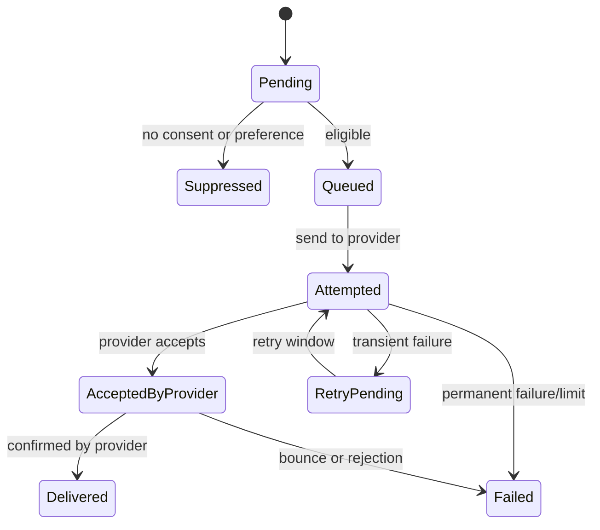

# Notification Delivery, Retry, and Preference Policy

**Status:** Draft - pending product/architecture review  
**Version:** 0.1.0  
**Prepared:** 2026-10-26

## Candidate workflow

Provider accepted does not guarantee delivery or read status; available statuses depend on channel.

## Proposed retry policy
Bounded exponential delay with jitter for network/transient provider errors, channel-specific caps, explicit classification of permanent invalid destinations and opt-outs, dead-letter/manual recovery for poison payloads. Exact retry count/delay must follow provider contract and approved SLO.

## Business idempotency
Intent identity is a stable combination of recipient, triggering business condition and reminder stage. Delivery attempts are technical child records. Intent state should not be recreated by duplicate Kafka events.

## Preference evaluation
Evaluate recipient preference at dispatch time, not solely when MaintenanceDueDetected was produced. Suppression requires auditable reason. Quiet hours use the recipient's timezone; if unknown, use a defined safe policy, not guessed local time.

## Tests
Duplicate due events, repeated provider timeout with unknown outcome, opt-out while queued, invalid email, app push token revoked, delayed response, template version change, timezone quiet-hour boundaries and partial outages.
