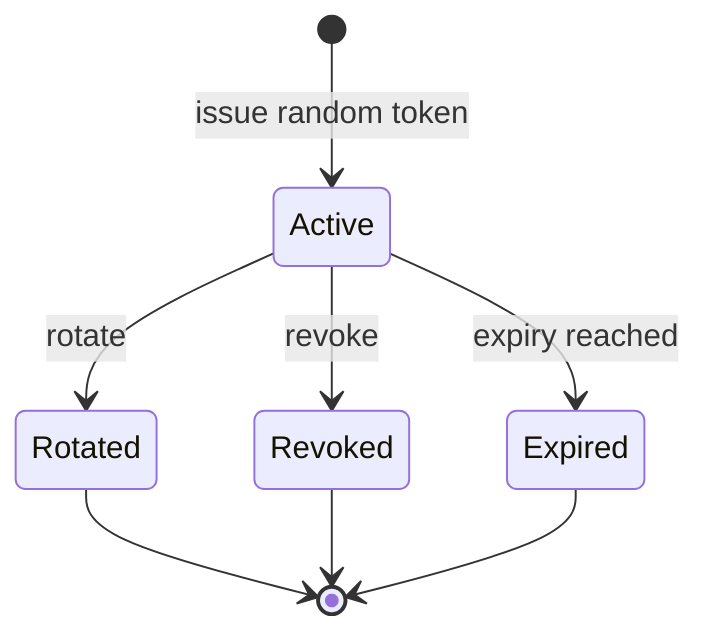

# QR Public Access Grant - Lifecycle and Revocation

**Status:** Draft - pending product/architecture review  
**Version:** 0.1.0  
**Prepared:** 2026-10-26

## State machine (proposed)

Rotation is conceptually revocation of old secret plus issuance of a new credential. Modeling it as a distinct state is an optional audit projection, not license for old token access.

## Grant issuance
Authorize resource and fields, create high-entropy random token, store only secure verification material plus scope and time metadata, return token **once** for QR generation. Never derive from internal VehicleId or use hash(VIN) as a secret.

## Public read
Validate credential and status first; ensure requested field set is a subset of current authorized scope; return only sanitized projection. Respect cache-control and disable unsafe client referrer leakage. Do not return invalid-grant details useful for enumeration.

## Revocation
Revoke the authoritative grant, invalidate or sharply bound caches, and ensure all subsequent privileged reads fail using revoked credential. Existing screenshots or copied already-disclosed data cannot be retracted; product UX must communicate this limitation.

## Threat exercise
Lost QR sticker, copied public URL, browser history, analytics referrer, brute force, repeated invalid tokens, revoked but cached response, owner changes, token shown in application logs, privacy opt-out, scanned vehicle with stale history.

## Acceptance criteria
A revocation test must show no authorized new content is accessible with old credential. A rotation test must show the old credential fails and only the replacement may access the approved fields. A different vehicle's token never grants access to this one.
