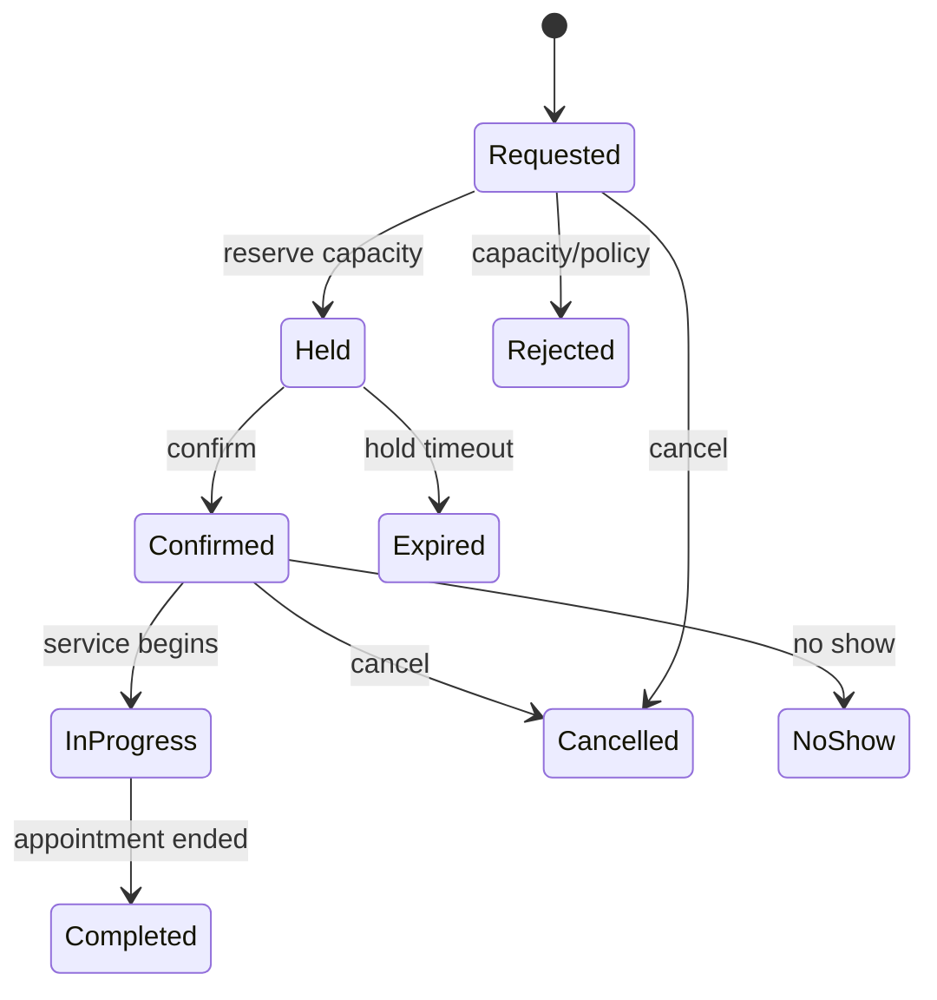

# Scheduling - Tactical Domain Blueprint

**Status:** Draft - pending product/architecture review  
**Version:** 0.1.0  
**Prepared:** 2026-10-26

## Mission
Own appointment reservations, availability and lifecycle independently of Maintenance's service orders and Inventory's stock.

## Candidate model
- `Appointment` Aggregate Root: id, vehicle ref, workshop/org ref, slot, requested service reference, status, version.
- `AvailabilityCalendar` or `ResourceSchedule` consistency boundary: resource identity, shifts, blackout periods, slot capacity.
- `TimeSlot(start, end, timeZone/zone context)` immutable VO; prefer absolute instants for reserved slots and IANA zone for local display/business calendar.
- `ResourceId`, `AppointmentId`, `OrganizationId` strong IDs.

## Candidate operations
`RequestAppointment`, `HoldSlot` if needed, `ConfirmAppointment`, `Reschedule`, `Cancel`, `RecordNoShow`; all require authorization and concurrent capacity safety. Maintenance may coordinate a booking Saga but Scheduling alone owns capacity validation.

## Proposed state machine

Decide whether `Held` is needed in V1; don't create a holding infrastructure without a real workflow.

## Consistency and integration
`AppointmentConfirmed`/`Rejected` are proposed Integration Events with stable business correlation and idempotency metadata. If a Saga times out, late confirmations must be reconciled or cancelled based on a documented workflow policy. Maintenance order changes may request appointment changes; they cannot directly edit Scheduling tables.

## Quality gates
Double-booking tests; daylight saving gap/overlap if operating beyond Costa Rica; same resource booked by concurrent requests; reschedule atomicity; cancellation of expired hold; time zone display; retry of confirmation; disabled resource; capacity changes while bookings exist.

## Open decisions
OD-009: resources (technician, lift, service bay, generic capacity), appointment duration, buffer periods, location, multi-timezone, waitlist and walk-in policy.
