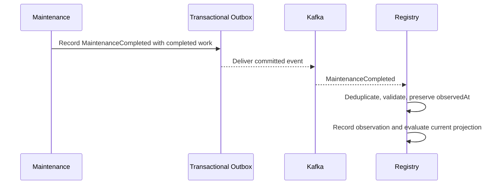

# Vehicle Registry - Tactical Domain Blueprint

**Status:** Draft - pending product/architecture review  
**Version:** 0.1.0  
**Prepared:** 2026-10-26

## Mission
Stable vehicle identity, mutable identification descriptors, temporally traceable ownership and provenance-aware odometer observations. **Accepted:** Vehicle Registry owns authoritative odometer; `MaintenanceCompleted` consumption is asynchronous (ADR-0016).

## Candidate aggregate design
| Aggregate candidate | Owns | Invariants / reasons | Boundary status |
| --- | --- | --- | --- |
| Vehicle | Immutable VehicleId, identity descriptor, lifecycle | Valid identity and transitions; versioned corrections | Strong candidate |
| VehicleOwnership | Party-vehicle temporal relation | Individual period transitions; cross-record policies harder | Needs OD-004 |
| OdometerLedger | Current accepted reading/epoch; observation acceptance | Concurrency and anomaly evaluation without loading entire history | Needs OD-005 |
| OdometerObservation | Historical source-attributed fact | Immutable append/correction linkage | Entity/record boundary TBD |

## Value objects
`VehicleId extends Id<UUID>`, `Vin`, `LicensePlate` with jurisdiction, `VehicleDescriptor`, `VehicleStatus`, `OwnershipPeriod`, `OdometerMeasurement(value, unit)`, `ObservationSource(type, recordId, revision, eventId)`, `OdometerEpoch` candidate.

## Commands and outcomes
- `RegisterVehicle`: allocate VehicleId, validate descriptor, persist aggregate+outbox atomically.
- `ChangeLicensePlate` or `CorrectIdentification`: maintain history and audit; do not mutate identity.
- `AddCoOwner`: check authorized Party and conflicts; one transaction for affected ownership state.
- `TransferOwnership`: close source, create destination; preserve all unrelated active co-owners.
- `RecordManualOdometer`: source validation + history + accepted-state evaluation.
- `RecordMaintenanceOdometerObservation`: Kafka inbound contract mapping; deduplicate technical event and logical maintenance source.

## Proposed events
`VehicleRegistered`, `VehicleIdentificationCorrected`, `OwnershipEstablished`, `OwnershipEnded`, `VehicleOdometerRecorded`, `OdometerObservationFlagged`. Public Integration Events are chosen separately from Domain Events.

## Important cross-context workflow

Maintenance success is not rolled back due to delayed Registry synchronization.

## Concurrency tests
Same owner source transferred twice; duplicate add-owner attempts; two VIN registrations with same jurisdictional identifier; two odometer events racing with manual update; old maintenance delivered after newer one; physical meter replacement; source revision/correction.

## Authorization and security
UserId must not be treated as PartyId; owner record is not proof of login entitlement. No VIN/plate-based enumeration; protect legal owner documents. Public Access receives only approved projections.

## Open decisions
Registry/Party ownership, VIN validation per vehicle type, ownership aggregate consistency, accepted odometer algorithm and meter epochs, scope of correction rights, tenant identity model. See ADR-0010/0015 Draft and OD-002 to OD-005.
