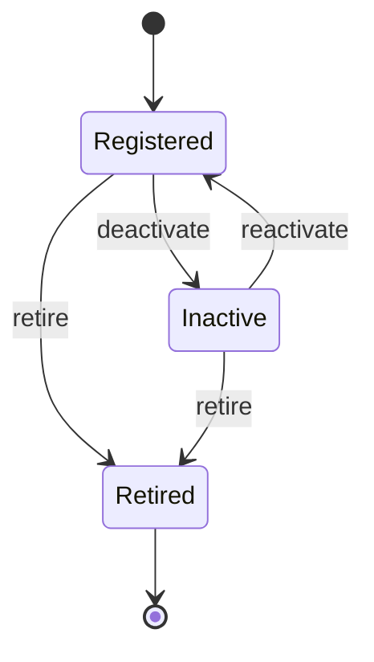

# Vehicle Registry - States, Time, and Concurrency

**Status:** Draft - pending product/architecture review  
**Version:** 0.1.0  
**Prepared:** 2026-10-26

## Candidate vehicle lifecycle

State names/policies are proposed. `Retired` need not mean deleted; reactivation semantics require approval.

## Ownership lifecycle
`Proposed` (optional verification) -> `Active` -> `Ended`, with `Rejected` and `Corrected` as audit outcomes. If a verification model is absent, do not invent fake verification. Periods should prefer `[from,to)` and preserve `effectiveAt` separate from `recordedAt`.

## Invariant scope
| Invariant | Scope | Proposed enforcement |
| --- | --- | --- |
| VehicleId immutable | Vehicle aggregate | Constructor/private state |
| No invalid lifecycle change | Vehicle aggregate | Domain methods |
| Co-owners preserved across transfer | Ownership set | Vehicle-scoped transactional boundary |
| No duplicate identical active relation | Ownership set | Transactional check + DB unique/exclusion policy |
| Current odometer not regressed by stale observation | Odometer acceptance | State/epoch version and domain policy |
| Logical maintenance observation once | Registry Inbox + source identity | Unique source reference + atomic txn |
| Observation history not silently erased | Observation store | Append/correction linkage |

## Odometer semantics
Store `observedAt` and `recordedAt`; preserve source; unit conversion with deliberate precision. Do **not** use `max(value)` globally. Corrections, rolled meters and replacement epochs can make smaller values legitimate. Anomaly quarantine/review disposition must be durable rather than message loss.

## Concurrency experiment specification
- Simultaneous ownership transfer of one source -> exactly one accepted successor; no partial records.
- Retroactive owner update vs active transfer -> policy conflict or deterministic reconciliation.
- Two independent readings same `maintenanceId+revision` -> one logical observation.
- Event delivered earlier/later than `observedAt` -> no illegal current-state regression.
- Invalid observation -> durable rejected/reviewed outcome with clear retry vs dead-letter classification.

## Policy gaps
V1 role of vehicle retirement, title-verification strength, unit granularity, cross-jurisdiction plate validation, events for corrected history, and current reading algorithm are unresolved.
