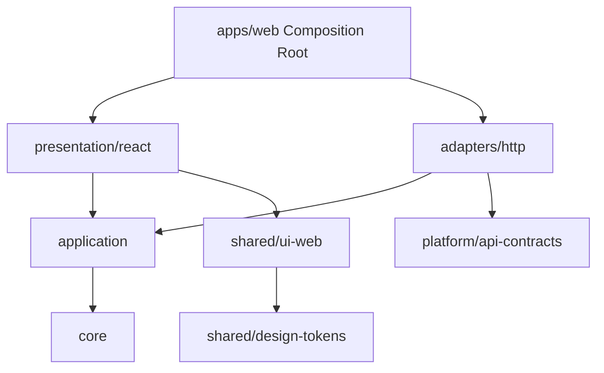

# Frontend Package Architecture and Technical Decision Brief

**Status:** Draft - pending product/architecture review  
**Version:** 0.1.0  
**Prepared:** 2026-10-26

## Approved architectural constraints
pnpm Workspaces and TypeScript; Next.js first web app; framework-independent Core/Application; transport adapters; composition root per app; no direct Kafka from clients. See ADR-0007/0008/0009/0014.

## Candidate workspace
```text
frontend/
  apps/web/
  domains/vehicles/{core,application,adapters/http,presentation/react}/
  domains/maintenance/{core,application,adapters/http,presentation/react}/
  domains/inventory/...  domains/scheduling/...  domains/public-access/...
  shared/{design-tokens,ui-web,ui-native}/
  platform/{api-contracts,authentication,observability}/
```
Directories and actual workspace package granularity should reflect real reuse; avoid an npm package for a single trivial type without a meaningful boundary.

## Dependency direction

Core and Application must not import React/Next or concrete adapters. Frontend models do not mirror backend aggregate objects by default. Generated DTOs remain behind adapters.

## Technical options to decide
| Topic | Candidate options | Key evaluation |
| --- | --- | --- |
| Server state | TanStack Query / framework facilities | SSR, invalidation, stale projections |
| Interaction state | React state/Jotai/Zustand | Boundary and state lifetime |
| API generation | OpenAPI generator/Orval/other | Contracts and runtime compatibility |
| Realtime | SSE vs WebSocket | Bidirectional requirement, auth, recovery |
| Forms | Accessible schema-driven/controlled | Domain errors, server validation |
| Component base | Headless primitives/design system | Accessibility and maintenance |
| Styling | CSS variables/Tailwind/other | Token reuse and platform portability |
| Package boundary checks | ESLint dependency rules/tooling | Automated architecture gate |

## SSR/security
Keep request-bound credentials out of module-global mutable singletons. A switching organization must not serve cached prior tenant records. Public QR page may be rendered separately with strict no-leak cache behavior.

## Testing
Core/Application tests run with Node runner and fake ports; adapter contracts use mocked/ephemeral transport; UI tests cover focus/inputs/status; app integration checks routing and auth isolation. Reject circular dependencies.

## Approval gate
Before implementation fix exact package names, tool versions, state split, generation path, server rendering strategy, design tokens, runtime environments and dependency guard rules.
