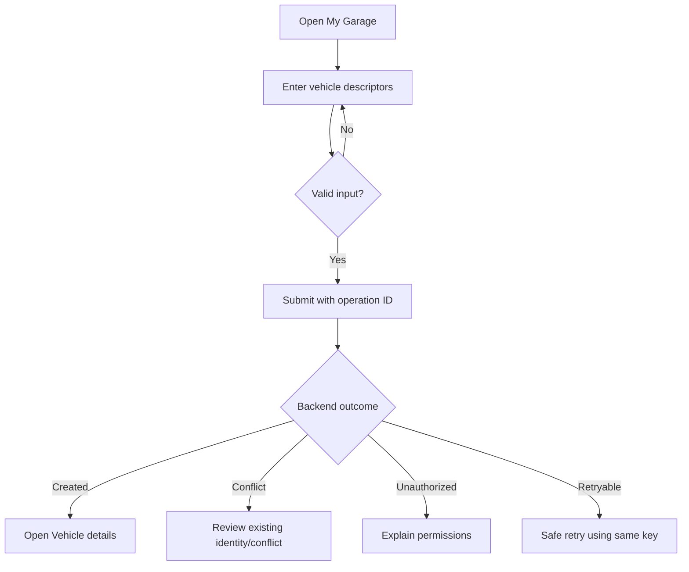

# Frontend User Interaction Flows

**Status:** Draft - pending product/architecture review  
**Version:** 0.1.0  
**Prepared:** 2026-10-26

## Common UX rules
Show progress for asynchronous operations, avoid duplicate command submission, distinguish permission denial from validation, persist navigation state carefully, and never make optimistic success claim for an unconfirmed business transition. Interactive forms must expose field-level and summary errors.

## F-01: vehicle registration

## F-02: owner maintenance completion
Select vehicle → choose maintenance type → enter performedAt, observed mileage, parts/details/cost (as approved) → preview provenance label → submit once with idempotency key → show Maintenance completed → show Registry mileage as *updating* when event propagation is pending → display flagged observation if Registry returns a review outcome later.

## F-03: ownership transfer
Select one active ownership relation (not all owners) → verify authority/evidence → choose destination Party and effective date → review unaffected co-owners → confirm versioned operation → handle concurrent conflict by refreshing context → audit result.

## F-04: workshop booking
New order → select approved vehicle and services → reserve parts and slot through workflow → show `PENDING` while Saga advances → on full success show confirmation → on partial failure show compensation progress and actionable recovery, not a fictitious 'confirmed' appointment.

## F-05: public QR issuance/revocation
Choose permitted field projection → preview *exact* public view → issue secret once → generate printable QR → verify on unprivileged view → revoke/rotate → demonstrate old URL no longer works; warn screenshots/copies cannot be recalled.

## F-06: permissions and switching organization
Display active org context → switch organization → invalidate/partition caches → reauthorize each view and action → remove access to stale restricted data → record affected grants appropriately.

## Error matrix
| Situation | UX |
| --- | --- |
| Validation error | Show field and summary text; keep safe inputs |
| Authorization denied | Hide sensitive existence details, offer eligible next step |
| Conflict 409/412 | Explain changed state, refetch, request confirmation |
| Operation pending | Show operation ID/status; no duplicate click |
| Retryable outage | Safe retry only when idempotency is guaranteed |
| Stale projection | Show freshness/synchronizing indicator |
| Saga needs intervention | Clear status + operational support path |
