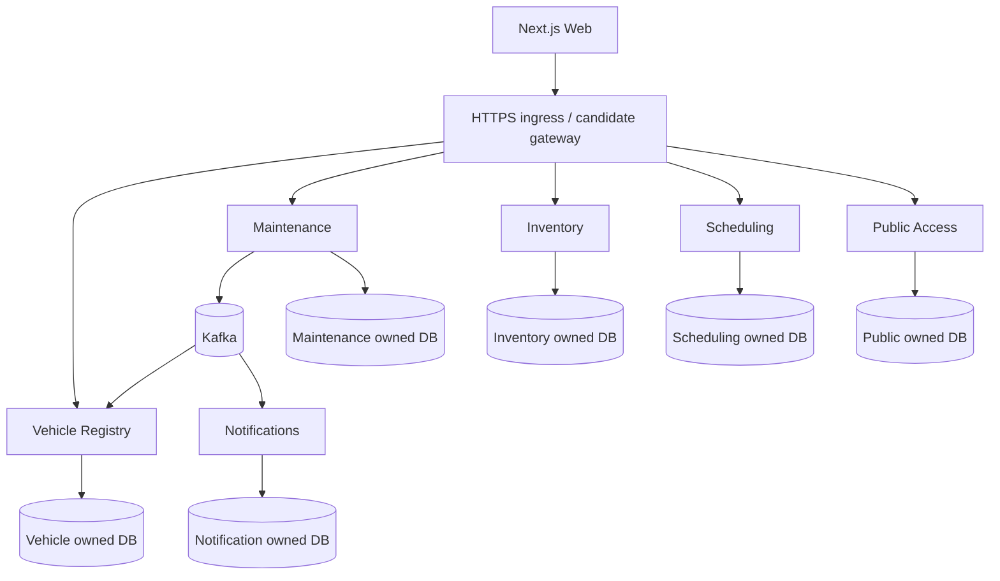

# Deployment Topology - Logical and Physical Alternatives

**Status:** Draft - pending product/architecture review  
**Version:** 0.1.0  
**Prepared:** 2026-10-26

## Status
Logical topology follows approved Java services, Kafka, PostgreSQL and Next.js, but the **physical deployment is unapproved** (ADR-0013 Draft). C4 container diagrams are *runtime elements*, not mandatory Docker container counts.

## Logical view

The diagram is representative, omits all optional response links and does not choose an orchestrator, exact ingress, managed database provider or Kafka service.

## Candidate stages
1. **Local dev:** compose-managed Kafka/PostgreSQL and selected services; run only relevant contexts; no assumed public networking.
2. **Staging:** isolated credentials, DBs, topics, storage, telemetry, synthetic users and contract validation.
3. **Production:** separately deployable service containers, independent DB ownership, ingress/TLS, autoscaling/backpressure where needed, private object storage, observability and backups.

## Deployment strategies to evaluate
| Option | Strength | Risk |
| --- | --- | --- |
| Single VM Compose | Cost/learning simplicity | Single-host failure/recovery and manual orchestration |
| Managed container platform | Less control-plane upkeep | Vendor coupling and service cost |
| Kubernetes | Strong operational primitives | High initial complexity and resource overhead |

## Isolation and networking
Services do not expose databases publicly. Kafka topic ACLs per service identity. Services have distinct DB credentials and migrations. Public QR endpoint is separately rate limited. Private document storage uses short-lived grants. TLS at all relevant ingress and internal boundaries, according to threat model.

## Stateful services
PostgreSQL backups and restore-tested migrations, Kafka retention and cluster durability, Outbox/Inbox retention, Saga state recovery and object storage backup must be included in physical sizing.

## Design decision gate
Choose provider(s), deployment runtime, failure domains, environment isolation, gateway, TLS termination, secrets manager, image registry, service discovery and cost targets; update ADR-0013 and disaster recovery plan before production.
