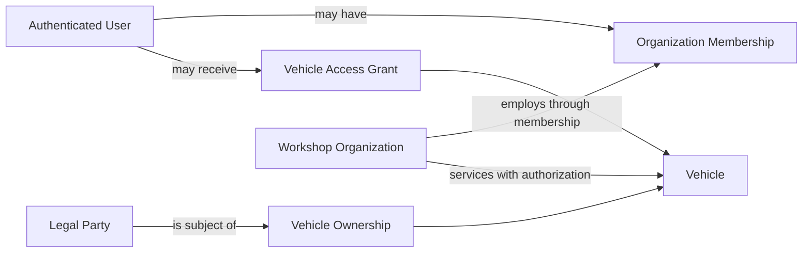

# Actors, Roles, and Personas

**Status:** Draft - pending product/architecture review  
**Version:** 0.1.0  
**Prepared:** 2026-10-26

## Distinctions
A **Party** is the legal/person-or-organization subject of an ownership relationship; a **User** is an authenticated account; a **Membership** relates a User to an Organization; a **Role** represents a permission grouping. These are independent notions. A Party need not have an account, and a workshop may service a vehicle without owning it.

## Actor catalog
| Actor ID | Actor | Goals | Security boundary | V1 relevance |
| --- | --- | --- | --- | --- |
| ACT-01 | Private vehicle caretaker | Register, inspect, maintain, plan | Vehicle access grant, not assumed legal title | Core |
| ACT-02 | Legal owner / co-owner Party | Establish or verify ownership | Ownership evidence and resource grants | Core |
| ACT-03 | Workshop technician | Work on assigned jobs; record observations | Assigned organization and work scope | Workshop candidate |
| ACT-04 | Workshop service advisor | Intake, schedule, communicate, complete service | Role + vehicle/service authorization | Workshop candidate |
| ACT-05 | Workshop manager | Inventory, staff, workshop policies | Organization-scoped admin | Workshop candidate |
| ACT-06 | Public QR visitor | View approved fields | Revocable QR bearer grant | QR candidate |
| ACT-07 | Fleet coordinator | Multi-vehicle operations | Organization membership and resource grants | Optional/deferred |
| ACT-08 | Platform operator | Investigate operational failures | Restricted administrative privileges, audit | Supporting |
| ACT-09 | External delivery provider | Deliver notifications | Provider integration contract | Supporting |

## Personas (illustrative, not real people)
### Owner-Mechanic
Keeps detailed service records for a motorcycle and a car; values exact kilometers, parts, dates, maintenance schedules, photo evidence, and the ability to distinguish self-performed service from verified workshop work. Primary friction: scattered history and uncertainty about next service.

### Service Advisor
Works in a workshop serving vehicles owned by other people; needs appointment availability, authorized past-service summaries, reserved parts and a clear completion workflow. Cannot assume a customer granted access to all prior workshops' private records.

### Inventory Coordinator
Needs reliable stock receipts, transfers (if supported), reservations, consumption, adjustment audit and concurrent stock safety; does not decide appointment confirmations.

### Co-owner Without Account
Is legally associated with a vehicle but does not necessarily have a login. The system must not equate recorded PartyId with UserId or create automatic app permissions.

### Public Visitor
Scans QR code; may see vehicle model and approved maintenance summary but never internal cost breakdown, identity documents or private owner data by default.

## Accessibility and localization
Journeys must work for keyboard use and small screens; use timezone-aware display and distance units; language/currency availability remains OD-026. Distinguish `performedAt`, `recordedAt`, and timezone in UI.

## Actor relationship model

## Open questions
How title is verified (OD-028); what organization may see after ownership transfer (OD-003, OD-024); impersonation/support model; minor owners, company ownership and delegated caretakers; which actors are active in V1.
